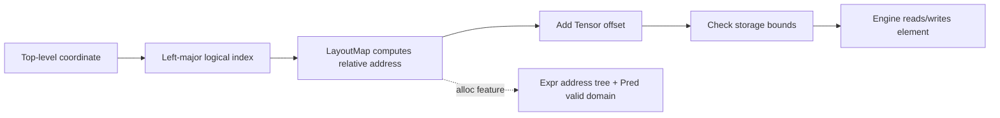

# Engineering implementation of noodle-cute

This document accompanies the [mathematical model](mathematical-model.md) and explains how the current code represents layouts, executes the layout algebra, checks Tensor accesses, and generates semantically equivalent index expressions. "Math §N" refers to section N of the companion document. The examples use the existing public API and need no CUDA or other device backend.

## 1. How modules map to the mathematical model

| Module | Main types or entry points | Mathematical model counterpart |
|---|---|---|
| [int.rs](../src/int.rs) | `Int<N>`, `DynInt`, `Integer` | Integer leaves and static values |
| [tuple.rs](../src/tuple.rs) | `IntTuple`, `Nil`, `Node`, `Shape` | Shape trees of §2 |
| [layout.rs](../src/layout.rs) | `LayoutMap`, `Layout`, `DynLayout`, `GroupedLayout` | Indexing, range, and simplification of §1–6 |
| [algebra.rs](../src/algebra.rs) | Composition, complement, inverse, divide/product, local views | Layout transformations of §6–12 |
| [partition.rs](../src/partition.rs) | Copy/MMA descriptors and thread–value mappings | Thread work assignment of §12–13 |
| [swizzle.rs](../src/swizzle.rs) | `Swizzle`, `SwizzledLayout`, `StagedTile` | Address bit transformations of §14 |
| [tensor.rs](../src/tensor.rs) | Engines, `Tensor`, copy and matrix algorithms | Logical element reads and writes of §15 |
| [expr.rs](../src/expr.rs) | `Expr`, `Pred`, `IndexExpr` | Symbolic formulas and valid domains of §16 |
| [lib.rs](../src/lib.rs) | Module exports, `Error`, checked `add/mul` | Public boundary and error propagation |

An actual data access goes through the steps below. Layout transformations usually change only the address formula in the middle; they do not move elements:



The crate is `no_std` by default, needs no heap allocation, and has no external Rust dependencies. Enabling `alloc` only adds the `Box`, `String`, and `Vec` used by expression trees; it does not implicitly enable `std` or a GPU backend. CPU reference algorithms can use borrowed slices or fixed arrays; "CPU reference" does not mean the core must depend on the standard library.

## Signed and unsigned boundaries in layout

`LayoutMap::size/extent`, `AffineLayoutMap::leaf_shape`, and the runtime `shapes()` use `usize`; strides, addresses, coordinates, and `cosize/address_end` still use `isize`. `DynLayout::new/left/right` keep their `&[isize]` interfaces and check for negative extents; `DynLayout::new_unsigned` accepts `&[usize]`, and both entry points validate the logical size and the reachable address range. The integer-leaf interface of typed layouts is still `isize`; negative values are rejected at the shape-access boundary before conversion to `usize`.

Size and address are checked for overflow separately. For example, `usize::MAX:0` is a valid broadcast layout whose logical size is `usize::MAX` and whose only reachable address is 0; it must not be truncated to a negative number just because the size exceeds `isize::MAX`. Coordinate–stride products use a wide integer intermediate and check that the result converts back to `isize`, so zero strides and negative strides that reach `isize::MIN` are both handled correctly. When a multi-dimensional coordinate is encoded as a linear index, the result must still be representable by the existing `index(isize)` interface; otherwise `Error::Overflow` is returned.

As in CuTe's `layout.hpp` / `stride.hpp`, left-major coordinate decoding, the last mode of the extended domain, and the merge condition of coalesce are unchanged. Rust does not adopt C++'s implicit signed/unsigned promotion: out-of-range conversions return `Error::Overflow`. Some intermediate values and shape parameters in the existing algebra are still `isize`, and conversions are checked explicitly when they receive unsigned layout metadata, so these paths still have signed range limits. Empty domains are detected by zero extents before the size product is computed; extents actually produced by coalesce must still be representable by `usize`.

## 2. Putting integers and tree structure into the type system

### 2.1 Static leaves and dynamic leaves

`Int<const N: i64>` has no runtime fields; the number is encoded in the type parameter, so it is a zero-sized type. `DynInt(i64)` and plain `i64` hold runtime values. `Integer::STATIC` lets algorithms distinguish "a constant known in the type" from "a variable that happens to take some value on this run".

The `binary!` macro generates implementations for addition, subtraction, multiplication, division, and remainder: an operation on two `Int`s yields an `Int`; if a dynamic operand is involved, the result becomes `DynInt`. Static results are expressed through named const items and `core::gca!`, and trait bounds and associated types reuse the same const definition.

GCA here stands for Generic Const Arguments, a nightly feature. `core::gca!` refers to a named const definition, which lets the type parameter of `Int<N>` take part in compile-time arithmetic and keeps the result in the type. A trait bound specifies a capability a type must have; an associated type declares what result type that capability produces.

These integer operators follow ordinary Rust integer rules and do not return `Result`. The overflow checks in the layout API do not imply that writing `DynInt(a) * DynInt(b)` directly also returns `Error::Overflow`. When a checked product is needed, use `Node::product` / `LayoutMap::size`; `product_typed` / `size_typed` preserve the result type.

### 2.2 Heterogeneous lists hold nested shapes

`IntTuple<H,T>` is a recursive heterogeneous list: H is the current mode, T is the remaining modes at the same level, and `Nil` marks the end. H can itself be an `IntTuple`, forming nesting; the length of the T chain does not increase the nesting depth.

`Item` provides `RANK`, `DEPTH`, `LEAVES`, and leaf access. `mode_span(axis)` returns the `(start, count)` of a top-level mode in the flattened leaf sequence, so algorithms can walk leaves while keeping top-level boundaries. `Profile` records only the tree shape, not values or static-ness.

The bound `D: Item<Profile = S::Profile>` on `Layout<S,D>` requires shape and stride to have the same tree. `Shape` rejects negative static extents through a crate-private compile-time condition on `Int<N>`; negative dynamic extents return `InvalidShape` at construction.

`shape!` and `stride!` both expand to the same tuple list, with parentheses creating nested modes. `get::<I>()` accepts any index the tuple has; invalid indices fail to compile.

```rust
use noodle_cute::layout::{Layout, LayoutMap};
use noodle_cute::tuple::Item;
use noodle_cute::{DynInt, Int, shape, stride};

fn main() -> noodle_cute::Result<()> {
    let _: Int<14> = Int::<2> + Int::<3> * Int::<4>;
    let layout = Layout::new(
        shape![Int::<2>, (DynInt(2), Int::<2>)],
        stride![Int::<4>, (Int::<2>, Int::<1>)],
    )?;
    assert_eq!(layout.rank(), 2);
    assert_eq!(layout.shape.depth(), 2);
    assert_eq!(layout.size()?, 8);
    assert_eq!(layout.index_of_coord(&[1, 2])?, 5);
    assert_eq!(layout.index(5)?, 5);
    assert_eq!(core::mem::size_of_val(&layout), 8);
    Ok(())
}
```

This example has only one dynamic field, so the layout occupies 8 bytes. When strides are constructed automatically, strides that depend on a dynamic extent also become dynamic fields; it is not true that "one dynamic shape leaf always adds exactly one field".

### 2.3 Shared machinery for typed algebra

`LayoutParts` in [`layout/static_layout.rs`](../src/layout/static_layout.rs) gives `Layout<S,D>` the associated types `Shape` and `Stride` plus an `into_layout` conversion. It expresses unvalidated intermediate layouts; the conversion returns the layout itself without validation or normalization. The composition stages `ComposeTree`, `ComposeLeaf`, `Fold`, `FoldStep`, `Finish`, and `FinishNonempty` all use `Output: LayoutParts`, and relay stages forward `Output` instead of re-deriving `Shape` and `Stride`.

These helper traits are implementation details: the algebra submodules are private, and `noodle_cute::algebra` re-exports only the operations, their typed traits (`TypedCompose`, `Complement`, `TypedDivide`, `TypedProduct`, `TypedInvert`), and the result aliases (`TypedComposition`, `TypedComplement`, `TypedDivided`, `TypedProductLayout`, `TypedInverse`, `CoalescedLayout`). `LayoutParts` is crate-internal.

One marker type, the crate-private `Bool<B>`, carries compile-time conditions both as `Bool<COND>: True` bounds and as impl dispatch (`Bool<true>` / `Bool<false>`). Typed divide and product select their grouping with `Kind<KIND>`, where `KIND` is one of the public constants `LOGICAL`, `ZIPPED`, `TILED`, `FLAT`, `BLOCKED`, and `RAKED`; coalesce keeps its own `Decision<u8>` for discard/retain/merge. `Unwrap` is a crate-internal tuple helper that removes one level.

`ceil_div` in `int` is a `const fn` shared by type-level and runtime paths and never forms `a+b-1`. Fully static results are read through the public `StaticValue` trait: every leaf of a static `Layout` is an `Int<N>`, so `<TypedComposition<A, B> as StaticValue>::VALUE` (and the other aliases) is the result as a constant. Plain mixed multiplication and the static-zero propagation of composition (`ComposeProduct`) keep their own type rules; generic-const bounds and associated-type projections refer to the same named consts.

### 2.4 Typed complement

[`algebra/complement.rs`](../src/algebra/complement.rs) holds the static, mixed, and runtime paths. `Complement<C,EXTENDED>` derives `TypedComplement`, whose fully static value is read through `StaticValue`. `LayoutParts` carries the intermediate layouts of filtering, sorting, the prefix, and the tail; the public methods validate the result with `Layout::new`.

The algorithm reuses `Flatten` / `Append` / `Unwrap`, coalesce's `Prepend` / `CoalesceFold` / `FinishCoalesce`, integer multiplication/division and `ceil_div`, and composition's `StepNumber` / `ZERO_STRIDE` / `ComposeProduct` dispatch. `complement_step` checks each gap and next stride for both the typed and runtime paths. Typed sorting follows upstream's requirement of static strides for multi-mode layouts; runtime sorting uses `LayoutBuilder` and `MAX_RANK` arrays.

Tests live in [`tests/complement_contract.rs`](../tests/complement_contract.rs). Entry points, type-preservation rules, and upstream deviations are described in [layout algebra §14.2](algebra.md#142-fully-static-mixed-and-runtime-entry-points).

### 2.5 Typed inverse, divide, and product

`TypedInvert<LEFT>` in [`inverse.rs`](../src/algebra/inverse.rs) derives `TypedInverse`. `Attach` records the original logical prefix product before sorting, and sorting reuses complement's stable `Sort`. The right inverse drops dynamic strides and extends the chain only through static equalities; the left inverse requires all strides to be static after coalescing. Only result leaves that depend on a dynamic shape become dynamic. The runtime `sorted_leaves` path and the enumerated inverses remain.

[`typed.rs`](../src/algebra/typed.rs) is the internal module shared by divide and product: `Transform` dispatches on integer, layout, or nested-tuple tilers, `Unzip` collects tile/rest by the upstream guide, `Regroup` selects the zipped/tiled/flat profile, and `Checked` runs the final `Layout::new`. Each operation only implements `Binary` for a single tiler and reuses composition and complement; the public methods and result types come from one internal macro.

`CoalesceTarget` in [`divide.rs`](../src/algebra/divide.rs) keeps the type of `shape(coalesce(L))`. In `product.rs`, blocked/raked pad the tiler with `1:0` modes to the block's rank before composing (`ProductOp<true>` with `PadModes`), then `ZipModes` zips block and rest per mode. Runtime tuple products and tuple divides share `group_modes` / `LayoutBuilder` and produce a one-level `GroupedLayout`; runtime single-tiler divide regroups the composed tile and rest so tiled/flat unpack the composed modes like upstream.

Fully static results read through `StaticValue` skip the final runtime size, address-range, and tiler checks; mixed methods keep dynamic fields and validate inputs and results before returning `Result`. Typed paths never go through runtime arrays, so their inputs and outputs may exceed `MAX_RANK`; runtime entry points keep the fixed capacity and the lazy maps.

Contracts live in [`inverse_contract.rs`](../tests/inverse_contract.rs), [`divide_contract.rs`](../tests/divide_contract.rs), and [`product_contract.rs`](../tests/product_contract.rs); `algebra_contract.rs` keeps `Grouping` / `TileRest` and cross-module laws. Algorithms, static-ness rules, and upstream deviations are in [layout algebra §21.1](algebra.md#211-fully-static-mixed-and-runtime-entry-points-for-inverse), [§27.1](algebra.md#271-fully-static-mixed-and-runtime-entry-points-for-divide), and [§35.1](algebra.md#351-fully-static-mixed-and-runtime-entry-points-for-product).

## 3. Three layout representations and their common contract

### 3.1 Choosing a representation by when the structure is known

| Representation | Stored content | When to use |
|---|---|---|
| `Layout<S,D>` | Two trees that keep static/dynamic leaf types | Structure known at compile time; zero-sized when fully static |
| `DynLayout` | Two `[i64;32]` arrays and a rank | Flat shape/stride computed at runtime |
| `GroupedLayout` | `DynLayout`, the leaf count of each top-level mode, and an `integral` flag | Layout algebra results that must keep one level of mode boundaries |

`MAX_RANK=32` bounds the fixed metadata buffers. Typed tuples themselves have no such limit: extended-domain evaluation and the injectivity proof of `Layout` read shape/stride directly by leaf index without conversion; only operations that export runtime metadata, such as `to_dyn` and `as_affine`, return `CapacityExceeded`.

The entries of `GroupedLayout::groups()` must sum to the number of flat leaves. For example, shape `(2,(2,3))` can be stored as leaves `[2,2,3]` with groups `[1,2]`. It does not keep all nesting boundaries of arbitrary depth. `integral` distinguishes an integer shape in the CuTe sense from a rank-1 tuple; the two may follow different top-level distribution rules under composition.

For example, when composed with outer `(4,6):(6,1)`, the integer inner `8:3` gives `(2,4):(18,1)` with two top-level modes, `groups=[1,1]`; the single-element tuple inner `(8,):(3,)` keeps the same two leaves in one top-level mode, `groups=[2]`. The addresses are the same, but the coordinate grouping differs; see `compose_grouped` in §5.2 for the branch.

### 3.2 `LayoutMap` represents an executable mapping

The required entry points of the trait are `size`, `rank`, `extent`, and `index`. The other methods provide coordinate entry points, the extended domain, the address interval, injectivity, and optional affine metadata.

`Layout::new` first validates that all shape leaves are non-negative, then checks the logical size and address endpoints for integer overflow. It allows zero/negative strides and repeated addresses. Whether a `Tensor` can write through this layout is a separate, later question.

The default `index_of_coord` checks bounds per top-level axis through `coord_to_linear`, builds the logical index from the extent prefix products, and passes it to `index`. The `index` of a basic layout decodes all leaves as in math §3; the skeleton of the algorithm is:

```text
first check 0 <= linear < size
address = 0
for each shape/stride leaf (s,d) in order:
    coordinate = linear % s
    linear = linear / s
    address = checked_add(address, checked_mul(coordinate,d))
```

Division and remainder are executed only after the non-empty valid domain has been verified. `checked_size` (called by `Layout` through `shape_size`) first scans all leaves, so that a zero extent cannot mask another negative extent; once a zero extent is confirmed, the size is 0 directly, avoiding a meaningless product overflow.

`affine_index_extended` does not take the remainder for the last leaf and handles a leafless domain separately. `index_extended_of_coord` applies this rule to each top-level mode separately (`Layout` obtains the mode's leaf range with `mode_span`); `DynLayout` has only one leaf per axis, so it accumulates `coord[a] * stride[a]` directly. A generic mapping can by default only be extended when it supports affine metadata; wrappers such as `SwizzledLayout` do not automatically gain unbounded extension.

### 3.3 Implementation cost of range and injectivity

Affine layouts compute the range with the endpoint formula of math §4, in time linear in the number of leaves; a generic `LayoutMap` enumerates all valid indices by default. `cosize` and `address_end` are computed from the range, not directly from the product of the shape.

`is_injective` of `Layout` and `DynLayout` shares `affine_injective`: a zero-stride leaf of length greater than 1 is immediately judged overlapping; the remaining leaves are picked one by one in ascending `(|stride|, leaf index)` order, and a proof of non-overlapping intervals is attempted. Each round selects the next leaf with a linear scan, so the cost is quadratic in the number of leaves, but no sort buffer is needed, so typed layouts are not limited by `MAX_RANK`. If the proof fails, pairs are enumerated. This is usually written `O(n²)`, meaning that doubling the number of logical elements can nearly quadruple the number of address comparisons; each index evaluation also walks the leaves. It is suitable as a correctness check; do not assume the check is cheap for arbitrarily large layouts.

## 4. Compact strides and type-preserving simplification

`Compact<LayoutLeft, Start>` and `Compact<LayoutRight, Start>` recursively pass an accumulated stride `Start` and return `(Stride,End)`. A leaf uses the current `Start` as its stride and passes `Start * extent` to the next leaf. `LayoutLeft::make` goes from left to right and `LayoutRight::make` from right to left; both start from type `Int<1>`.

This is exactly the prefix-product/suffix-product construction of math §3. The constructor first pre-checks with checked arithmetic, then performs the type-preserving recursive multiplication. Even if a shape's final size is zero, constructing the intermediate strides may still require an unrepresentable product and return `Overflow`.

The coalesce algorithm lives in [`src/algebra/coalesce.rs`](../src/algebra/coalesce.rs) and has three entry points that share the discard/merge rules of the reverse fold:

| Input | Plain simplification | Preserving the extended mapping |
|---|---|---|
| Fully static `Layout` | `<CoalescedLayout<S, D> as StaticValue>::VALUE` | `<CoalescedLayout<S, D, true> as StaticValue>::VALUE` |
| `Layout` with mixed or fully dynamic leaves | `Layout::coalesce` | `Layout::coalesce_extended` |
| Runtime metadata `DynLayout` | `DynLayout::coalesce` | `DynLayout::coalesce_extended` |

The fully static result type comes from `CoalesceFold<EXTENDED>` and its value from `StaticValue`; there is no runtime recursion and no `DynLayout`, so it is not limited by `MAX_RANK`. The plain version normalizes an empty result to `1:0`; the extended version keeps the stride of a trailing shape-1 mode. Reading a constant this way skips `Layout::new`'s size and address-range validation; invalid static shapes are rejected by the `Shape` bound, and overflow of a static merge product is reported as an error at type instantiation.

The plain fold and the extended fold share the empty-tail initialization `PrependToEmpty<S,D,EXTENDED>`: the retain branch does not depend on EXTENDED; a static unit mode is deleted in the plain branch and kept with extent 2 in the extended branch to preserve the trailing stride. The three-way merge policy and the `1:0` convention for empty input are unchanged.

The two `Layout` methods still accept fully static input, but they are runtime-validating entry points that return `Result`. They flatten first and then call the same `CoalesceFold`. `UNIT_DECISION` deletes only static unit modes; `MERGE_DECISION` requires the current shape, the current stride, the first shape of the tail, and the first stride of the tail all to be static and to satisfy `s*d == next_stride`, matching CuTe's `bw_coalesce`. Hence `(Int<2>, DynInt(3)):(Int<1>, Int<2>)` keeps two modes; happening to be contiguous at runtime cannot change the type. All merge products are computed from static integers, so dynamic merge products no longer need a pre-check. The methods check the size and address range of the input shape and of the result.

The two `DynLayout` methods share `coalesce_impl`, which folds from right to left, assembles the result in a reversed workspace, and finally reverses the valid leaves. Here the current values may be used to delete unit modes and merge contiguous modes; merged extents use checked multiplication. The fold order matches the type level: for example, `(isize::MAX,2,0):(0,0,0)` first merges `2*0` into `0:0` and does not falsely report overflow by computing `isize::MAX*2` first.

The extended version corresponds to CuTe's `coalesce_x`; all three entry points keep the trailing stride that determines the extension direction. The type level replaces a trailing static shape-1 with 2; a dynamic shape-1 keeps its original value. Hence the logical size of a typed extended result may increase; `CoalescedLayout<S,D,true>` names its result type, while the plain version keeps the default `false`. `DynLayout` keeps the trailing leaf by keeping a nonzero rank and retains the real extent, avoiding extra overflow from a placeholder extent; extended indexing does not use the last extent. This is an explicit deviation from upstream's static representation; the output's logical size still equals that of the original runtime layout. An empty layout follows this library's scalar convention and is normalized to `1:0`. Equivalence of the extended mapping requires the leading extents of the original layout to be positive; with zero extents, simplification still follows CuTe's algebraic rules, and the division-by-zero error of the original extended decoding is not guaranteed to be preserved.

## 5. How the layout algebra executes

### 5.1 Public interface and working buffers

`AffineLayout` provides flat metadata through `as_flat_layout` and grouped metadata through `as_grouped_layout`. `LayoutMap::as_affine` is an optional capability on generic mappings that returns `Option<GroupedLayout>`; `None` means no affine representation is currently known.

The crate-internal `LayoutBuilder` in `layout/dynamic_layout.rs` collects shape/stride leaves and top-level mode sizes in fixed arrays; `group_modes` in `algebra.rs` assembles the groupings shared by runtime divide/product. These helper structures place the results selected at runtime into a `DynLayout` or `GroupedLayout` without allocating heap memory for each algebra operation.

### 5.2 Entry points of the composition algorithm

`composition_layout` computes metadata immediately. `compose_grouped` first coalesces outer while preserving the extended domain, then distributes by inner's top-level modes; each integer leaf `s:d` is handed to `compose_leaf`. The latter uses the extents of outer's modes, the current remaining extent, and the stride to split off result leaves with division, remainder, and ceiling division, and checks the divisibility conditions.

When constructing `Composition<A,B>`, `composition` caches the affine result that satisfies the normalization conditions, even if weak divisibility makes it differ from pointwise composition; when the operands are not divisible or the result is not affine, the pointwise fallback is kept; other errors are returned directly.

`Composition::index` therefore only chooses between evaluating the cached layout and `outer.index_extended(inner.index(i))`. Its `size` comes from inner; `rank`/`extent` follow the normalized layout when there is one (matching `composition_layout`), and inner's modes otherwise.

```rust
use noodle_cute::algebra::{composition, composition_layout};
use noodle_cute::layout::{DynLayout, LayoutMap};

fn main() -> noodle_cute::Result<()> {
    let outer = DynLayout::new(&[4, 6], &[6, 1])?;
    let inner = DynLayout::new(&[8], &[3])?;
    let normal = composition_layout(&outer, &inner)?;
    assert_eq!(normal.shapes(), &[2, 4]);
    assert_eq!(normal.strides(), &[18, 1]);
    let composed = composition(outer, inner)?;
    assert!(composed.is_normalized());
    assert_eq!(composed.index(2)?, 1);
    assert_eq!(outer.index_extended(inner.index(2)?)?, 13);
    Ok(())
}
```

These assertions directly show the exception in math §7; the implementation cannot be replaced by "composition is always pointwise substitution".

When both sides have only `Int<N>` leaves, `TypedComposition<A, B>` runs the same algorithm during trait resolution: `CoalesceFold<true>` in the shared module performs `coalesce_x`; plain `Layout::coalesce` uses the default branch of the same fold, and both share the discard/merge rules of `Prepend`; `ComposeTree` recurses over inner's tree, and each step of `Fold` computes its values with `const fn step` and writes them back into the type as generic consts. The result is a zero-sized `Layout` that can be placed in a `const` and does not go through `LayoutBuilder`/`DynLayout`; divisibility, overflow, and profile errors all fail compilation at instantiation. See [layout algebra §7.1](algebra.md#71-fully-static-results) for details.

Fully static, mixed, and runtime composition are all implemented in [`src/algebra/composition.rs`](../src/algebra/composition.rs). A fully static result is read as `<TypedComposition<A,B> as StaticValue>::VALUE`; `Layout::composition` returns `Result<TypedComposition<A,B>>`; both share the type recursion of `ComposeTree` / `Fold` / `Finish`, with stage results unified as `Output: LayoutParts`. The mixed path's `TypedStep` produces `Int<N>` only when the relevant parameters are statically known, and `DynInt` otherwise; runtime unit modes do not change the output tree. A static zero multiplied by a dynamic value and a static zero numerator divided by a dynamic value follow CuTe's special rules.

`composition_layout` returns a `GroupedLayout`; the generic `composition` keeps the lazy fallback. The typed methods allow negative strides and check dynamic divisibility, division by zero, and overflow; compared with upstream, which omits dynamic assertions, this is an explicit checked deviation. Typed results and constant results do not go through fixed-capacity buffers, so they are not limited by `MAX_RANK`. Typed coalesce and runtime coalesce may keep different mode boundaries, and under weak divisibility the numeric result may change with the available static information; see [layout algebra §7.3](algebra.md#73-fully-static-mixed-and-runtime-entry-points-for-composition). Runtime, mixed, and static contracts are in [`tests/composition_contract.rs`](../tests/composition_contract.rs).

### 5.3 Complement, divide, and product

`complement_prefix` first rejects empty domains and filters; if the result is `1:0`, it returns `None` as a special-case marker, in which case `complement_shape` returns `prod(cotarget):1` directly and `complement_extended` returns `1:1`. Otherwise it sorts by `(stride, original index)`; the second sort key keeps a deterministic order for equal strides. The regular path maintains the current gap of math §8 and appends gap leaves; then `complement_shape` takes the ceiling per target leaf, and `complement_extended` keeps the trailing repeat stride.

`TileRest::index` uses `i % tile_size` to select the tile index and `i / tile_size` to select the rest index, then adds the two addresses. Single-tiler divide and product therefore need no separate coordinate engine: the former builds the complement and composes the result onto the original layout; the latter composes rest onto the block's complement without a cotarget.

`divide_modes` builds tile/rest per original top-level mode. The four public `*_divide_modes` only differ in how they group the result. `rank_product` builds blocked/raked results mode by mode up to the larger rank of the two sides, keeping the padded `1:0` leaves.

```rust
use noodle_cute::{complement, complement_extended, logical_divide, DynLayout, LayoutMap};

fn main() -> noodle_cute::Result<()> {
    let block = DynLayout::new(&[4], &[2])?;
    assert_eq!(block.cosize()?, 7);
    let rest = complement(block, 24)?;
    assert_eq!(rest.leaf_shape(), &[2, 3]);
    assert_eq!(rest.leaf_stride(), &[1, 8]);
    let repeated = complement_extended(block)?;
    assert_eq!(repeated.leaf_shape(), &[2, 1]);
    assert_eq!(repeated.leaf_stride(), &[1, 8]);

    let divided = logical_divide(DynLayout::left(&[6])?, DynLayout::left(&[4])?)?;
    assert_eq!(divided.size()?, 8);
    assert_eq!(divided.index_of_coord(&[3, 1])?, 7);
    Ok(())
}
```

The last address can be computed from the layout, but six-element storage cannot hold it. In practice, choose a predicated view or provide sufficiently padded storage.

### 5.4 Structured inverse and enumerated inverse

`sorted_leaves` computes the prefix products of the coalesced shape and sorts by stride. `right_inverse` accepts only leaves whose stride equals the currently covered length, and the output stride uses that leaf's logical prefix product. `left_inverse` builds the reverse shape from the divisibility relation between adjacent scales, allows address holes, and skips zero strides.

`dense_left_inverse` first checks injectivity and the address range; `dense_right_inverse` enumerates whether each target address has a preimage. Both return `Inverse<L>`; it builds no heap lookup table, and `index(address)` scans from index 0 of the original layout on every call and returns the first hit. This saves allocation, but one query may need to scan all elements. Expression export for this type returns `Unsupported`.

## 6. How slices and local views connect to Tensor

This section first describes how Tensor attaches the layouts and local views of §3–5 to a memory engine, corresponding to the storage model of math §15. Once views are established, the concrete copy and matrix-multiplication reference algorithms are covered in §11.

### 6.1 Roles of the engine, the layout, and the offset

The three private fields of `Tensor<E,L>` are `engine`, `layout`, and `offset`. `ReadEngine` defines the length and reads values by storage index; `WriteEngine` adds mutable writes. Currently provided:

| Engine | Storage relation | Read/write |
|---|---|---|
| `SliceEngine<'a,T>` | Borrows `&[T]` | Cloning reads |
| `SliceMutEngine<'a,T>` | Exclusively borrows `&mut [T]` | Cloning reads and writes |
| `ArrayEngine<T,N>` | Owns `[T;N]` | Cloning reads and writes |
| `IdentityEngine<R>` | Stores the shape, no element array | Generates `[i64;R]` coordinates from the left-major index |

`&E` and `&mut E` also forward the engine traits, so `view` / `subview` can borrow the same engine and copy only the layout metadata. Writable views borrow the parent through `&mut`, and Rust checks the borrow exclusivity.

When a Tensor is constructed, `validate_range` uses the whole reachable address range to check that `offset + min/max` lies within the engine. On access, `storage_index` again performs a checked addition, converts to `usize`, and checks the upper bound. The signed offset must be added before converting to an unsigned index, so that the reversed views of math §15 are handled correctly.

Writable constructors check injectivity first. All write entry points also call `validate_write`, because a writable engine may also be placed into a Tensor through the generic read-only constructor. `copy_if`, `fill`, and the matrix algorithms validate the destination layout once before the loop; per-element `set` checks on every call.

### 6.2 Slicing returns a layout and an offset

`DynLayout::slice` walks the selectors, keeps `All` axes, removes fixed axes, and accumulates the address offset. The generic `slice` stores the selectors as `Sliced<L>`, rebuilds the original coordinate on every index, and subtracts the base address it returned up front. It suits mappings that cannot be split directly into new strides.

The two differ in the offset rule for empty views: `DynLayout::slice` still accumulates the contributions of fixed axes; the generic `slice` returns offset 0. Downstream code should use the offset actually returned and not assume that the two paths give the same base address for empty views.

`Tensor::subview` adds the given offset to the parent Tensor's offset; it only requires the new view to lie within the underlying engine, not that the new coordinate domain be a subset of the parent view.

```rust
use noodle_cute::{copy, slice, DynLayout, Slice, Tensor};

fn main() -> noodle_cute::Result<()> {
    let input = [0, 1, 2, 3, 4, 5];
    let src = Tensor::from_slice(&input, DynLayout::left(&[3, 2])?)?;
    let mut storage = [0; 6];
    let mut dst = Tensor::from_slice_mut(&mut storage, DynLayout::right(&[3, 2])?)?;
    copy(&src, &mut dst)?;
    assert_eq!(storage, [0, 3, 1, 4, 2, 5]);

    let (column, offset) = slice(*src.layout(), &[Slice::All, Slice::Index(1)])?;
    assert_eq!(offset, 3);
    let view = src.subview(column, offset)?;
    assert_eq!(view.get_linear(2)?, 5);

    let reversed = Tensor::from_slice_at(&input, DynLayout::new(&[6], &[-1])?, 5)?;
    assert_eq!(reversed.get_linear(0)?, 5);
    assert_eq!(reversed.get_linear(5)?, 0);
    Ok(())
}
```

### 6.3 The two tail-tile interfaces need different handling

`local_tile_layout` calls `inner_partition`, slices rest, and returns a `GroupedLayout` and an offset. It lets padding slots enter the extended domain and suits callers that control predicates or padded storage themselves. `local_partition_layout` first decodes the thread index with `get_flat_coord`, then calls `outer_partition`.

`local_tile`, by contrast, stores the original layout, the tile shape, and the global origin. `global_coord` decodes each local index and checks bounds; invalid tail slots return `None`. Its `address_range` counts only valid slots, so a tail tile can be bound directly to the original unpadded storage.

```rust
use noodle_cute::{copy_if, local_tile, DynLayout, Tensor};

fn main() -> noodle_cute::Result<()> {
    let input = [0, 1, 2, 3, 4, 5];
    let tail = local_tile(DynLayout::left(&[6])?, &[4], &[1])?;
    let src = Tensor::from_slice(&input, tail.clone())?;
    let mut storage = [-1; 4];
    let mut dst = Tensor::from_slice_mut(&mut storage, DynLayout::left(&[4])?)?;
    copy_if(&src, &mut dst, |i| tail.valid_linear(i).unwrap())?;
    assert_eq!(storage, [4, 5, -1, -1]);
    Ok(())
}
```

The closure's `unwrap` here relies on `copy_if` passing only indices in `[0,size)`. `copy_if` evaluates the predicate first and then computes the source and destination addresses; invalid slots neither read the source nor modify the destination. A plain `copy` or `fill` does not skip tail slots automatically.

The one-dimensional `local_partition` stores the thread count and the thread index, forwards to the original layout using `thread + i*threads`, and computes the thread's real size, so there are no extra tail slots to mask.

## 7. How Copy partitioning implements thread ownership

`CopyAtom` stores the number of values per operation and the alignment in bytes. `TiledCopy` stores the tile, the thread count, the element count, the slots per thread, and an optional `ThreadValueLayout`. The constructors check for positive lengths, product overflow, and atom divisibility.

`TiledCopy::new` uses the cyclic formula of math §12; `with_layout` instead decodes thread and value coordinates independently and then computes `t + v * thread_shape`. `linear_index` keeps tail slots; `coordinate` uses `Option` to distinguish inactive tail slots from the `Err` produced by an invalid thread/value index. The `CopyPartition` iterator skips inactive slots.

```rust
use noodle_cute::{CopyAtom, PartitionOrder, ThreadValueLayout, TiledCopy};

fn main() -> noodle_cute::Result<()> {
    let cyclic = TiledCopy::new(CopyAtom::new(2)?, [5, 2], 3)?;
    assert_eq!(cyclic.values_per_thread(), 4);
    assert_eq!(cyclic.linear_index(1, 2)?, 8);
    assert_eq!(cyclic.coordinate(2, 2)?, None);
    let plan = cyclic.cyclic_plan()?;
    assert!(plan.is_active(1, 2));
    assert_eq!(plan.coordinate(1, 2), (3, 1));
    assert!(!plan.is_active(2, 2));

    let mapping = ThreadValueLayout::new(
        [2, 2], [2, 1], PartitionOrder::FirstMajor, PartitionOrder::FirstMajor,
    )?;
    let explicit = TiledCopy::with_layout(CopyAtom::scalar(), mapping)?;
    assert_eq!(explicit.tile_shape(), [4, 2]);
    assert_eq!(explicit.coordinate(1, 1)?, Some([3, 0]));
    Ok(())
}
```

`cyclic_plan` converts a validated cyclic assignment into a `CyclicCopy` that holds only scalar metadata, making it easy to inline in device code. It supports only cyclic assignment. `coordinate` has no `Result`, so callers must satisfy `is_active` first; out-of-domain arithmetic uses wrapping, and coordinates returned for out-of-domain inputs must not be used for storage access.

`make_layout_tv` does not call the restricted two-dimensional formula above; it reuses `raked_product → right_inverse → composition_layout`. It returns the layout from tile coordinates to `(thread, value)` indices and the reverse TV layout. This path is a direct instance of deriving thread assignment from the mathematical model.

## 8. How MMA partitioning reuses the layout algebra

### 8.1 `MmaAtom` / `TiledMma`

`MmaAtom` stores the shape, the thread count, and an optional capability description. `MmaCapabilities` contains the input type, the accumulator type, and whether fragments are opaque; these are tags needed for backend matching and do not query a device for support.

`TiledMma::with_group_grid` validates the given group grid directly. `new` derives the group count from the total thread count, enumerates the `(gm,gn)` that evenly divide the atom grid, and selects the grid by the difference between the height and width within a group. `group_origin` decodes the group index with remainder and quotient, and `partition_a/b/c` all return scalar `TiledCopy`s. This API describes the logical staging assignment; the shape of B is `(K,N)`.

### 8.2 `MmaAtomLayout` / `TiledMmaLayout`

This API lets callers supply the TV description of a hardware atom explicitly. `MmaAtomLayout::new` checks that the atom extents are positive, the TV rank is 2, the size of the thread mode matches the size of `ThrID`, and the total TV size equals the area of the corresponding atom tile. It does not fully validate the bijectivity or hardware legality of an arbitrary TV description.

`TiledMmaLayout::new` forms the VMNK thread layout from `complement_extended(ThrID)` and per-mode composition; its semantics are the `tiled_product` of math §13. Missing M/N/K modes are padded with `1:0`; the strides of unit leaves are set to zero to obtain a deterministic output form.

The internal `thrfrg` selects axes by operand: `(M,K)` for A, `(N,K)` for B, and `(M,N)` for C, then:

1. Apply `logical_divide_modes` with the per-axis permutation.
2. Split off the atom tile and the remaining positions by the atom size.
3. Apply `composition_layout` to the atom tile and the caller-provided atom TV.
4. Further partition rest along the relevant VMNK thread axes.
5. Return the thread modes and fragment modes separately; `partition_*` computes the offset from the concrete thread coordinate.

```rust
use noodle_cute::{DynLayout, LayoutMap, MmaAtomLayout, TiledMmaLayout};

fn main() -> noodle_cute::Result<()> {
    let atom = MmaAtomLayout::universal_fma()?;
    let grid = DynLayout::new(&[2, 4, 1], &[1, 2, 8])?;
    let mma = TiledMmaLayout::new(atom, &grid, [None, None, None])?;
    assert_eq!(mma.thread_count()?, 8);
    assert_eq!(mma.tile_size_mnk()?, [2, 4, 1]);
    let c = DynLayout::left(&[8, 8])?;
    let (fragment, offset) = mma.partition_c(&c, 5)?;
    assert_eq!(fragment.leaf_shape(), &[1, 4, 2]);
    assert_eq!(fragment.leaf_stride(), &[0, 2, 32]);
    assert_eq!(offset, 17);
    assert_eq!(offset + fragment.index_of_coord(&[0, 1, 1])?, c.index_of_coord(&[3, 6])?);
    assert_eq!(mma.layout_c_tv()?.index_of_coord(&[5, 0])?, 5);
    Ok(())
}
```

`layout_*_tv` also pads the thread dimensions that A/B do not use with zero strides, and maps thread indices back to thread coordinates through the structured inverse. The extended-domain behavior of C when K is split also comes from this construction chain. It does not allocate register fragments or perform cross-thread reductions.

## 9. Checked and direct computation paths of Swizzle

`Swizzle<B,M,S>` is a zero-sized type; the three parameters of math §14 are all encoded in the type. `new` uses a const bound to validate that the bit fields do not overlap and lie within the non-sign bits. Because unit structs and `Default` can also produce instances, `apply` still checks the parameters and rejects negative addresses.

`apply` first converts to `u64`, selects the source bit field, shifts it to the destination bit field, and XORs it back into the original value. `SwizzledLayout::index` applies the swizzle after the underlying layout computes the address; it forwards injectivity because a valid swizzle is a bijection, but the address range must be re-enumerated. The current wrapper has no affine metadata export and no dedicated implementation of extended indexing.

`offset(usize)` is a const, inlinable computation entry point without `Result`. `StagedTile::new` validates the size of each level and the period divisibility condition; `StagedTile::offset` only evaluates the formula, and the caller is responsible for stage/row/col bounds. Device adaptation must also ensure that `usize` is wide enough for the bit fields and offsets in use.

With the nightly in use, calling `Swizzle::new`, which carries type-level boolean bounds, requires the caller to enable the following two features as well:

```rust
#![feature(gca_min_const_items, gca_const_items)]

use noodle_cute::{StagedTile, Swizzle};

fn main() -> noodle_cute::Result<()> {
    let swizzle = Swizzle::<3, 3, 3>::new()?;
    assert_eq!(swizzle.apply(64)?, 72);
    assert_eq!(swizzle.apply(72)?, 64);
    assert_eq!(Swizzle::<3, 3, 3>::offset(64), 72);
    let staged = StagedTile::<3, 3, 3>::new(8, 64, 2)?;
    assert_eq!(staged.stage_elems(), 512);
    assert_eq!(staged.offset(1, 1, 0), 512 + 72);
    Ok(())
}
```

## 10. Exporting expression trees from the CPU computation

### 10.1 AST and evaluator

With `alloc` enabled, `Expr` holds an abstract syntax tree (AST): constants `Const`, named parameters `Param`, coordinate references `Coord`, arithmetic/bitwise nodes, and the conditional node `Select`. `Pred` holds comparisons, and, or, and not.

Rust operator overloading builds the trees. A constructor folds a subtree into a `Const` only when both operands are constants and the checked computation succeeds; nodes with division by zero, overflow, and similar errors are kept and reported at actual evaluation. `Pred` simplifies always-true/always-false predicates, the remaining `And` and `Or` nodes short-circuit, and `Select` evaluates only the selected branch.

`Expr::eval` takes a parameter lookup callback and a coordinate slice and does not depend on any backend language. Integer division truncates toward zero; right shift uses Rust's signed right-shift semantics. Shift checks verify that the shift amount is valid; bits shifted out at the top are not treated as ordinary multiplication overflow.

### 10.2 Basic layouts export the same decoding formula

The main entry points of `IndexExpr` are:

| Method | Output and purpose |
|---|---|
| `index_expr` | Linear index to address formula on the strict domain |
| `index_coord_expr` | Top-level coordinate is linearized first, then the address formula is generated |
| `size_expr` / `extent_expr` | Formulas for the total size and the size of a single mode |
| `domain_pred` / `coord_domain_pred` | Valid domain of a linear index or of per-mode coordinates |
| `index_expr_extended` / `extended_domain_pred` | Extended index formula and its valid domain, depending on the type's support |
| `expression_params` | Binding table of parameter names to their current valid metadata values |

A basic `Layout` queries `leaf_static` each time it accesses a leaf. Static leaves produce constants directly; dynamic leaves produce `{prefix}_shape_{leaf}` or `{prefix}_stride_{leaf}`. Leaf numbers follow the flattened order. Every leaf of a `DynLayout` is exported as a parameter, even if its current value is 0 or 1.

The CPU steps "take the remainder to get the current coordinate, keep decoding the quotient, multiply by the stride and sum" are built step by step into the same tree in expression export. A static zero extent can emit a harmless constant address early; a dynamic empty domain relies on `domain_pred` for protection. `nonnegative_product` uses `Select` to confirm that all extents are positive before computing the product, so that an empty domain such as `[i64::MAX,2,0]` does not overflow the product first.

```rust
use noodle_cute::{shape, stride, DynInt, Expr, IndexExpr, Int, Layout, LayoutMap};

fn main() -> Result<(), Box<dyn std::error::Error>> {
    let layout = Layout::new(
        shape![Int::<2>, DynInt(3)],
        stride![Int::<3>, Int::<1>],
    )?;
    let params = layout.expression_params("L")?;
    assert_eq!(params, vec![("L_shape_1".to_string(), 3)]);
    let lookup = |name: &str| params.iter().find(|(k, _)| k == name).map(|(_, v)| *v);
    let address = layout.index_expr(Expr::coord(0), "L")?;
    let valid = layout.domain_pred(Expr::coord(0), "L")?;
    for i in 0..layout.size()? {
        assert!(valid.eval(&lookup, &[i])?);
        assert_eq!(address.eval(&lookup, &[i])?, layout.index(i)?);
    }
    assert_eq!(address.eval(&lookup, &[4])?, 2);
    assert!(!valid.eval(&lookup, &[6])?);
    // Evaluated only to show out-of-bounds wraparound; real accesses must pass valid first.
    assert_eq!(address.eval(&lookup, &[6])?, 0);
    Ok(())
}
```

This example needs the `alloc` feature. Separating the valid domain from the address formula is an execution contract: evaluate the predicate first, then compute the address, and finally access the engine. Checking only that the final address lies within storage is not enough, because an out-of-bounds logical coordinate may wrap through the remainder operation to a valid address.

Here `i=6` is outside the logical domain of size 6, yet the address expression wraps to 0. This assertion only shows the behavior of this particular expression on invalid input; in general, an address expression may divide by zero or overflow when the predicate is false, and its evaluation result must not be relied on.

### 10.3 Recursive export of wrapper layouts

Each wrapper follows its CPU path while extending the parameter namespace:

| Wrapper | How the formula is built | Main prefixes or parameters |
|---|---|---|
| `Composition` | Substitute the inner address into outer's extended formula, or export the normalized cache | `_inner`, `_outer`, `_normalized` |
| `OffsetLayout` | Underlying address plus offset | `_layout`, `_offset` |
| `TileRest` | Remainder selects tile, quotient selects rest, and the two are added | `_tile`, `_rest` |
| `LocalTile` | Decode the local index, add the global origin, and call the parent coordinate formula | `_tile_a`, `_origin_a`, `_layout` |
| `LocalPartition` | Turn the index into `thread + i*threads` | `_thread`, `_threads`, `_layout` |
| `Sliced` | Rebuild the parent coordinate and subtract the address of the slice origin | `_selected_a`, `_layout` |
| `SwizzledLayout` | Add mask, shift, and XOR to the underlying address tree | Reuses the underlying parameters |

In the table, `a` is a placeholder for the axis number. `GroupedLayout` forwards the flat leaf expressions directly, and mode sizes are products over the groups. `IdentityLayout` returns the linear index expression directly; the shape parameters are used only for the size and the valid domain.

`TiledCopy::predicate_expr` also checks the thread range, the value-slot range, cyclic tail slots, and the two-dimensional global range after adding the origin. Checking only the decoded two-dimensional coordinate cannot replace the full predicate.

Rebindable parameters do not mean that any number is valid. The caller must maintain the constraints from construction time, for example a positive thread count, partitions that still divide evenly, and non-negative swizzle input. The leaf structure of a normalized composition may depend on the current dynamic values; after changing outer/inner, rebuild the composition and the expressions. Complement, inverse, and grouping metadata computed from concrete values should also be rebuilt along with their inputs; an already derived array must not be treated as a symbolic relation that still tracks the original inputs automatically.

The public AST lets backends generate code node by node, but this crate has no target-language code generator, GPU memory-space model, or automatic vectorized instruction selection.

## 11. How the CPU reference algorithms use layouts

`copy` reuses `copy_if` with an always-true predicate; it only requires both sides to have the same logical size. In the loop, the same linear index goes through the source and destination layouts to compute addresses, which is how the earlier example performs the row-/column-major conversion. `fill` writes only elements reachable by the layout, and `clear` calls `fill` with the element type's `Default` value.

`gemm` and `matmul` both first validate that the three Tensors have rank 2 and check that M/N/K are consistent. The loop order is N outer, M middle, K inner; A/B are read through the coordinate entry point each time, so padding, transposed layouts, and offsets participate naturally in the computation.

```rust
use noodle_cute::{gemm, matmul, DynLayout, Tensor};

fn main() -> noodle_cute::Result<()> {
    let av = [1i32, 2, 3, 4, 5, 6];
    let bkn = [7, 8, 9, 10, 11, 12];
    let bnk = [7, 9, 11, 8, 10, 12];
    let a = Tensor::from_slice(&av, DynLayout::right(&[2, 3])?)?;
    let b = Tensor::from_slice(&bkn, DynLayout::right(&[3, 2])?)?;
    let bt = Tensor::from_slice(&bnk, DynLayout::right(&[2, 3])?)?;
    let mut output = Tensor::from_array([0; 4], DynLayout::right(&[2, 2])?)?;
    matmul(&a, &b, &mut output)?;
    assert_eq!(output.engine().0, [58, 64, 139, 154]);
    let mut accumulated = Tensor::from_array([1; 4], DynLayout::right(&[2, 2])?)?;
    gemm(&a, &bt, &mut accumulated)?;
    assert_eq!(accumulated.engine().0, [59, 65, 140, 155]);
    Ok(())
}
```

The difference is that `gemm` reads the original C as the initial accumulator value and accesses B as `(N,K)`; `matmul` starts from `T::default()` and accesses B as `(K,N)`. When K is zero, the former still reads and writes the original C without changing its value; the latter writes default zero values. Addition and multiplication of the numeric type do not go through the layout layer's checked `add/mul`.

These functions do not call `TiledMma` or `TiledCopy` to generate parallel execution automatically. They provide scalar results that can be checked directly; the thread assignment descriptors are for other execution layers.

## 12. Errors, tests, and reproduction

### 12.1 Which layer an error comes from

| Error | Typical trigger |
|---|---|
| `InvalidShape` | Negative dynamic extent; zero tile or thread count where a positive value is required; invalid vector parameters |
| `StructureMismatch` | Incompatible coordinate rank, selector count, or mode structure |
| `CoordinateOutOfBounds` / `AxisOutOfBounds` | Accessing an invalid coordinate, or querying a nonexistent axis/leaf |
| `Overflow` | Address, size, or conversion out of integer range |
| `NonInjective` | Aliasing in a layout being written, or a complement that violates the gap requirement |
| `NotSurjective` | The contiguous coverage starting from zero that an enumerated inverse requires does not hold |
| `NotDivisible` | A partition, composition, or atom/grid violates the divisibility condition |
| `Unsupported` | The current operation cannot handle the layout, e.g. expression export of an enumerated inverse |
| `AddressOutOfBounds` | A Tensor's final address falls outside the engine, or a swizzle input is negative |
| `SizeMismatch` | Different copy sizes, inconsistent matrix dimensions, or mismatched atom TV size |
| `CapacityExceeded` | Derived metadata exceeds the fixed array capacity |

Expression evaluation separately uses `ExprError` to distinguish missing parameters, missing coordinates, overflow, division by zero, and invalid shifts. Parameter validity and memory accessibility are constraints at different levels; a successfully constructed layout does not mean that every engine can hold it.

### 12.2 Which mathematical facts the existing tests verify

| Test file | Main evidence |
|---|---|
| [core_contract.rs](../tests/core_contract.rs) | Static types and zero-size properties; independently enumerated addresses; simplification, inverse, partitioning, tail tiles |
| [cute_alignment_contract.rs](../tests/cute_alignment_contract.rs) | Structural and address results for P1–P5: cosize, extended domain, normalization, complement, TV, partitioning, and TiledMMA |
| [upstream_contract.rs](../tests/upstream_contract.rs) | Literal address tables for nested coordinates, signed strides, composition, and complement |
| [tensor_contract.rs](../tests/tensor_contract.rs) | Copy across storage orders, reversed views, rejection of broadcast writes, subviews, matrix results, and empty domains |
| [partition_contract.rs](../tests/partition_contract.rs) | All threads together cover the tile exactly; inactive slots; explicit grids and cyclic plans |
| [expression_contract.rs](../tests/expression_contract.rs) | CPU addresses agree with expressions under `alloc`; bounds, short-circuiting, parameters, and errors |
| [sm89_swizzle.rs](../tests/sm89_swizzle.rs) | const and checked swizzle agree; the given bank model and stage layout |

The source documentation also contains compile-fail tests verifying that invalid static shapes, shape/stride structure mismatches, invalid swizzles, and conflicting writable borrows do not compile. These tests prove type boundaries; they are not runtime `Result` branches.

The expected values in the alignment tests are based on the C++ oracle in the repository; [cute_oracle/run.sh](../tests/cute_oracle/run.sh) can regenerate the output given the CUTLASS headers, the CUDA headers, and a C++ compiler. Ordinary Rust tests read the embedded expected values and do not run this script; they do not prove GPU instruction execution or performance.

### 12.3 How to run the current code snapshot

The current [Cargo.toml](../Cargo.toml) inherits `version` and `edition` from the workspace, but the repository root of this directory snapshot has no workspace `Cargo.toml`, nor the `rust-toolchain.toml` described in the README. Running the crate's Cargo manifest directly reports "workspace root not found". This is a gap in the existing build context; this document does not change it.

The source uses `gca_min_const_items`, `gca_const_items`, and `generic_const_items` and needs the corresponding nightly. This document was verified offline with the locally installed `nightly-2026-10-11`, through a temporary standalone manifest that references the original sources and tests directly. The following commands, run from the repository root that contains `noodle-cute`, reproduce this approach; the temporary version number is only for the verification build:

```sh
cute_doc_check="$(mktemp -d)"
python3 - "$cute_doc_check" <<'PY'
from pathlib import Path
import sys

root = Path("noodle-cute").resolve()
work = Path(sys.argv[1])
parts = [
    '[package]', 'name = "noodle-cute"', 'version = "0.0.0"',
    'edition = "2024"', '', '[workspace]', '',
    '[features]', 'default = []', 'alloc = []', '',
    '[lib]', f'path = "{root / "src/lib.rs"}"',
]
for test in sorted((root / "tests").glob("*.rs")):
    parts += ['', '[[test]]', f'name = "{test.stem}"', f'path = "{test}"']
(work / "Cargo.toml").write_text("\n".join(parts) + "\n")
print(f"Temporary manifest: {work / 'Cargo.toml'}")
PY
cargo +nightly-2026-10-11 test --manifest-path "$cute_doc_check/Cargo.toml" --offline
cargo +nightly-2026-10-11 test --manifest-path "$cute_doc_check/Cargo.toml" --offline --features alloc
```

The default configuration runs 58 integration tests and 6 source doctests; the `alloc` configuration runs 70 integration tests and the same 6 source doctests. This document additionally extracted the complete Rust examples above into temporary tests for verification; Cargo does not automatically test code blocks in standalone Markdown files.

The `Swizzle::new` example above explicitly enables the two GCA features needed to call its type bounds; the other examples use concrete constant arguments and need no extra features. Callers that use `gca!` directly in generic bounds or types must also enable the corresponding GCA features; declaring their own generic const items additionally requires `generic_const_items`.

## 13. Correspondences to keep when reading and modifying

Tracing the input of one `Layout::index` through to the engine read/write shows how math §3 and §15 connect; then reading `divide_modes → inner_partition → Tensor::subview` shows that tiling is always a regrouping of indices. To understand thread ownership, first look at the direct `TiledCopy::linear_index`, then at `make_layout_tv`, which is derived from product and inverse, and finally at `TiledMmaLayout::thrfrg`.

When modifying the implementation, check three quantities separately: the coordinate structure, the finite valid domain, and the final address. The same set of addresses does not guarantee the same logical index order, and equivalence on the finite domain does not guarantee equivalence on the extended domain. When expression export is involved, also check the valid-domain predicates against the CPU path and update the parameter binding rules at the same time. The counterexamples in the companion [mathematical model](mathematical-model.md) and the contract tests linked in this document give concrete criteria for these boundaries.
