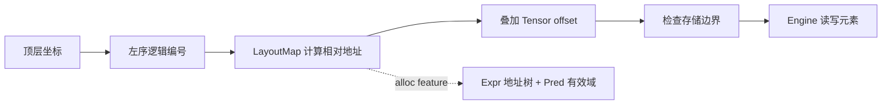

# noodle-cute 的工程实现

本文对应[数学模型](mathematical-model.md)，解释当前代码怎样表示布局、执行布局代数、检查 Tensor 访问，并生成同义的索引表达式。文中的“数学 §N”指配套文档的第 N 节。示例使用现有公开 API，不需要 CUDA 或其他设备后端。

## 1. 模块如何对应数学模型

| 模块 | 主要类型或入口 | 对应数学模型 |
|---|---|---|
| [int.rs](../src/int.rs) | `Int<N>`、`DynInt`、`Integer` | 整数叶子与静态值 |
| [tuple.rs](../src/tuple.rs) | `IntTuple`、`Nil`、`Node`、`Shape` | §2 的形状树 |
| [layout.rs](../src/layout.rs) | `LayoutMap`、`Layout`、`DynLayout`、`GroupedLayout` | §1–6 的索引、范围和化简 |
| [algebra.rs](../src/algebra.rs) | 组合、补布局、求逆、divide/product、局部视图 | §6–12 的布局变换 |
| [partition.rs](../src/partition.rs) | Copy/MMA 描述符及线程—值映射 | §12–13 的线程分工 |
| [swizzle.rs](../src/swizzle.rs) | `Swizzle`、`SwizzledLayout`、`StagedTile` | §14 的地址位变换 |
| [tensor.rs](../src/tensor.rs) | 引擎、`Tensor`、复制与矩阵算法 | §15 的逻辑元素读写 |
| [expr.rs](../src/expr.rs) | `Expr`、`Pred`、`IndexExpr` | §16 的符号公式与有效域 |
| [lib.rs](../src/lib.rs) | 模块导出、`Error`、受检 `add/mul` | 公共边界与错误传递 |

实际数据访问分成下面几步。布局变换通常只改变中间的地址公式，不搬动元素：



crate 默认是 `no_std`，不依赖堆分配，也没有外部 Rust 依赖。启用 `alloc` 只增加表达式树使用的 `Box`、`String`、`Vec`，不隐式启用 `std` 或 GPU 后端。CPU 参考算法可使用借用切片或固定数组；“CPU 参考”不意味着核心必须依赖标准库。

## layout 中的有符号与无符号边界

`LayoutMap::size/extent`、`AffineLayoutMap::leaf_shape` 和运行时 `shapes()` 使用 `usize`；stride、地址、坐标以及 `cosize/address_end` 仍使用 `isize`。`DynLayout::new/left/right` 保留接受 `&[isize]` 的接口并检查负 extent；`DynLayout::new_unsigned` 接受 `&[usize]`，两种入口都验证逻辑大小和可达地址范围。typed layout 的整数叶子接口仍为 `isize`，在 shape 访问边界拒绝负值后转换为 `usize`。

大小与地址分别检查溢出。例如 `usize::MAX:0` 是合法的广播布局，逻辑大小为 `usize::MAX`，可达地址只有 0；不能因为大小超过 `isize::MAX` 就把它截断成负数。坐标与 stride 相乘使用宽整数中间值，并检查结果能否转换回 `isize`，因此零 stride 和可达 `isize::MIN` 的负 stride 都能正确处理。将多维坐标编码成线性编号时，结果仍须能由现有 `index(isize)` 接口表示，否则返回 `Error::Overflow`。

与 CuTe `layout.hpp` / `stride.hpp` 一致，左序坐标解码、扩展域的最后一维和 coalesce 的合并条件不变。Rust 不采用 C++ 的隐式有符号/无符号提升：越界转换返回 `Error::Overflow`。现有 algebra 的部分中间值和 shape 参数仍为 `isize`，接收无符号 layout 元数据时显式检查转换，因此这些路径仍有有符号范围限制。空域先识别零 extent，再计算大小乘积；coalesce 实际生成的 extent 则仍必须能由 `usize` 表示。

## 2. 把整数与树结构放进类型系统

### 2.1 静态叶子与动态叶子

`Int<const N: i64>` 没有运行时字段，数字编码在类型参数里，因此是零大小类型。`DynInt(i64)` 以及原生 `i64` 保存运行时值。`Integer::STATIC` 让算法区分“类型已知的常量”和“这次运行恰好取某个值的变量”。

`binary!` 宏为加、减、乘、除、余数生成实现：两个 `Int` 运算，结果仍是 `Int`；出现动态操作数，结果变成 `DynInt`。静态结果通过命名 const item 与 `core::gca!` 表达，trait 约束和关联类型复用同一个 const 定义。

这里的 GCA 是 Generic Const Arguments（泛型常量参数），属于 nightly 特性。`core::gca!` 引用命名的常量定义，使 `Int<N>` 的类型参数可以参与编译期算术推导，并把结果继续放在类型中。trait 约束规定类型必须满足的能力，关联类型则声明该能力产生什么结果类型。

这里的整数运算符遵循普通 Rust 整数规则，不返回 `Result`。不能因为布局 API 有溢出检查，就认为直接写 `DynInt(a) * DynInt(b)` 也会返回 `Error::Overflow`。需要受检乘积时，使用 `Node::product` / `LayoutMap::size`；`product_typed` / `size_typed` 用来保留结果类型。

### 2.2 异构列表保存嵌套形状

`IntTuple<H,T>` 是递归异构列表：H 是当前模式，T 是同层余下模式，`Nil` 表示结尾。H 可以再次是 `IntTuple`，形成嵌套；T 的链长不增加嵌套深度。

`Item` provides `RANK`, `DEPTH`, `LEAVES`, and leaf access. `mode_span(axis)` returns the `(start, count)` of a top-level mode in the flattened leaf sequence, so algorithms can walk leaves while keeping top-level boundaries. `Profile` records only the tree shape, not values or static-ness.

The bound `D: Item<Profile = S::Profile>` on `Layout<S,D>` requires shape and stride to have the same tree. `Shape` rejects negative static extents through a crate-private compile-time condition on `Int<N>`; negative dynamic extents return `InvalidShape` at construction.

`shape!` and `stride!` both expand to the same tuple list, with parentheses creating nested modes. `get::<I>()` accepts any index the tuple has; invalid indices fail to compile.

```rust
use noodle_cute::layout::{Layout, LayoutMap};
use noodle_cute::tuple::Item;
use noodle_cute::{DynInt, Int, shape, stride};

fn main() -> noodle_cute::Result<()> {
    let _: Int<14> = Int::<2> + Int::<3> * Int::<4>;
    let layout = Layout::new(
        shape![Int::<2>, (DynInt(2), Int::<2>)],
        stride![Int::<4>, (Int::<2>, Int::<1>)],
    )?;
    assert_eq!(layout.rank(), 2);
    assert_eq!(layout.shape.depth(), 2);
    assert_eq!(layout.size()?, 8);
    assert_eq!(layout.index_of_coord(&[1, 2])?, 5);
    assert_eq!(layout.index(5)?, 5);
    assert_eq!(core::mem::size_of_val(&layout), 8);
    Ok(())
}
```

本例只有一个动态字段，所以布局占 8 字节。自动构造 stride 时，依赖动态长度的步长也会成为动态字段；并非“一个动态 shape 叶子永远只增加一个字段”。

### 2.3 Shared machinery for typed algebra

`LayoutParts` in [`layout/static_layout.rs`](../src/layout/static_layout.rs) gives `Layout<S,D>` the associated types `Shape` and `Stride` plus an `into_layout` conversion. It expresses unvalidated intermediate layouts; the conversion returns the layout itself without validation or normalization. The composition stages `ComposeTree`, `ComposeLeaf`, `Fold`, `FoldStep`, `Finish`, and `FinishNonempty` all use `Output: LayoutParts`, and relay stages forward `Output` instead of re-deriving `Shape` and `Stride`.

These helper traits are implementation details: the algebra submodules are private, and `noodle_cute::algebra` re-exports only the operations, their typed traits (`TypedCompose`, `Complement`, `TypedDivide`, `TypedProduct`, `TypedInvert`), and the result aliases (`TypedComposition`, `TypedComplement`, `TypedDivided`, `TypedProductLayout`, `TypedInverse`, `CoalescedLayout`). `LayoutParts` is crate-internal.

One marker type, the crate-private `Bool<B>`, carries compile-time conditions both as `Bool<COND>: True` bounds and as impl dispatch (`Bool<true>` / `Bool<false>`). Typed divide and product select their grouping with `Kind<KIND>`, where `KIND` is one of the public constants `LOGICAL`, `ZIPPED`, `TILED`, `FLAT`, `BLOCKED`, and `RAKED`; coalesce keeps its own `Decision<u8>` for discard/retain/merge. `Unwrap` is a crate-internal tuple helper that removes one level.

`ceil_div` in `int` is a `const fn` shared by type-level and runtime paths and never forms `a+b-1`. Fully static results are read through the public `StaticValue` trait: every leaf of a static `Layout` is an `Int<N>`, so `<TypedComposition<A, B> as StaticValue>::VALUE` (and the other aliases) is the result as a constant. Plain mixed multiplication and the static-zero propagation of composition (`ComposeProduct`) keep their own type rules; generic-const bounds and associated-type projections refer to the same named consts.

### 2.4 Typed complement

[`algebra/complement.rs`](../src/algebra/complement.rs) holds the static, mixed, and runtime paths. `Complement<C,EXTENDED>` derives `TypedComplement`, whose fully static value is read through `StaticValue`. `LayoutParts` carries the intermediate layouts of filtering, sorting, the prefix, and the tail; the public methods validate the result with `Layout::new`.

The algorithm reuses `Flatten` / `Append` / `Unwrap`, coalesce's `Prepend` / `CoalesceFold` / `FinishCoalesce`, integer multiplication/division and `ceil_div`, and composition's `StepNumber` / `ZERO_STRIDE` / `ComposeProduct` dispatch. `complement_step` checks each gap and next stride for both the typed and runtime paths. Typed sorting follows upstream's requirement of static strides for multi-mode layouts; runtime sorting uses `LayoutBuilder` and `MAX_RANK` arrays.

Tests live in [`tests/complement_contract.rs`](../tests/complement_contract.rs). Entry points, type-preservation rules, and upstream deviations are described in [layout algebra §14.2](algebra.md#142-全静态混合与运行时入口).

### 2.5 Typed inverse, divide, and product

`TypedInvert<LEFT>` in [`inverse.rs`](../src/algebra/inverse.rs) derives `TypedInverse`. `Attach` records the original logical prefix product before sorting, and sorting reuses complement's stable `Sort`. The right inverse drops dynamic strides and extends the chain only through static equalities; the left inverse requires all strides to be static after coalescing. Only result leaves that depend on a dynamic shape become dynamic. The runtime `sorted_leaves` path and the enumerated inverses remain.

[`typed.rs`](../src/algebra/typed.rs) is the internal module shared by divide and product: `Transform` dispatches on integer, layout, or nested-tuple tilers, `Unzip` collects tile/rest by the upstream guide, `Regroup` selects the zipped/tiled/flat profile, and `Checked` runs the final `Layout::new`. Each operation only implements `Binary` for a single tiler and reuses composition and complement; the public methods and result types come from one internal macro.

`CoalesceTarget` in [`divide.rs`](../src/algebra/divide.rs) keeps the type of `shape(coalesce(L))`. In `product.rs`, blocked/raked pad the tiler with `1:0` modes to the block's rank before composing (`ProductOp<true>` with `PadModes`), then `ZipModes` zips block and rest per mode. Runtime tuple products and tuple divides share `group_modes` / `LayoutBuilder` and produce a one-level `GroupedLayout`; runtime single-tiler divide regroups the composed tile and rest so tiled/flat unpack the composed modes like upstream.

Fully static results read through `StaticValue` skip the final runtime size, address-range, and tiler checks; mixed methods keep dynamic fields and validate inputs and results before returning `Result`. Typed paths never go through runtime arrays, so their inputs and outputs may exceed `MAX_RANK`; runtime entry points keep the fixed capacity and the lazy maps.

Contracts live in [`inverse_contract.rs`](../tests/inverse_contract.rs), [`divide_contract.rs`](../tests/divide_contract.rs), and [`product_contract.rs`](../tests/product_contract.rs); `algebra_contract.rs` keeps `Grouping` / `TileRest` and cross-module laws. Algorithms, static-ness rules, and upstream deviations are in [layout algebra §21.1](algebra.md#211-inverse-的全静态混合与运行时入口), [§27.1](algebra.md#271-divide-的全静态混合与运行时入口), and [§35.1](algebra.md#351-product-的全静态混合与运行时入口).

## 3. 三种布局表示与公共契约

### 3.1 根据结构何时确定来选择表示

| 表示 | 保存内容 | 适用情形 |
|---|---|---|
| `Layout<S,D>` | 两棵保留静态/动态叶子类型的树 | 结构在编译期确定；全静态时零大小 |
| `DynLayout` | 两个 `[i64;32]` 数组和 rank | 运行时计算出的扁平 shape/stride |
| `GroupedLayout` | `DynLayout`、每个顶层模式的叶子数、`integral` 标志 | 布局代数结果，需要保留一层模式边界 |

`MAX_RANK=32` 限制固定元数据缓冲区。类型化 tuple 本身没有这个上限：`Layout` 的扩展域求值与单射证明直接按叶子下标读取 shape/stride，不经转换；只有 `to_dyn`、`as_affine` 这类导出运行时元数据的操作会返回 `CapacityExceeded`。

`GroupedLayout::groups()` 的各项之和必须等于扁平叶子数。例如 shape `(2,(2,3))` 可保存为叶子 `[2,2,3]` 和分组 `[1,2]`。它不保留任意深度的全部嵌套边界。`integral` 区分 CuTe 意义上的整数 shape 与 rank 为 1 的 tuple，组合时二者的顶层分配规则可能不同。

例如与 outer `(4,6):(6,1)` 组合时，整数 inner `8:3` 的结果为 `(2,4):(18,1)`，有两个顶层模式，`groups=[1,1]`；单元素元组 inner `(8,):(3,)` 则把相同的两片叶子保留在一个顶层模式内，`groups=[2]`。地址计算相同，但坐标分组不同，具体分支见 §5.2 的 `compose_grouped`。

### 3.2 `LayoutMap` 表示可执行映射

trait 的必要入口是 `size`、`rank`、`extent`、`index`。其他方法给出坐标入口、扩展域、地址区间、单射性和可选仿射元数据。

`Layout::new` 先验证所有 shape 叶子非负，再检查逻辑大小和地址端点的整数溢出。它允许零/负 stride，也允许地址重复。`Tensor` 是否能写这个布局，是后面的独立问题。

默认 `index_of_coord` 通过 `coord_to_linear` 逐顶层轴检查边界，使用 extent 前缀积生成逻辑编号，再交给 `index`。基础布局的 `index` 对全部叶子做数学 §3 的解码，其算法骨架是：

```text
先检查 0 <= linear < size
address = 0
依次读取每个 shape/stride 叶子 (s,d)：
    coordinate = linear % s
    linear = linear / s
    address = checked_add(address, checked_mul(coordinate,d))
```

先验证非空有效域，才会执行除余。`checked_size`（`Layout` 经 `shape_size` 调用）先看完所有叶子，确保零长度不会掩盖另一个负长度；确认存在零长度后，大小直接为 0，避免无意义的乘积溢出。

`affine_index_extended` 对最后一个叶子不取余，对无叶子域单独处理。`index_extended_of_coord` 对每个顶层模式分别调用该规则（`Layout` 用 `mode_span` 取得模式的叶子区间）；`DynLayout` 每轴只有一个叶子，所以直接累加 `coord[a] * stride[a]`。通用映射默认只能在支持仿射元数据时延伸，`SwizzledLayout` 等包装并不自动获得无限扩展能力。

### 3.3 范围与单射性的实现成本

仿射布局用数学 §4 的端点公式求范围，时间随叶子数线性增长；通用 `LayoutMap` 默认枚举所有有效编号。`cosize` 与 `address_end` 基于范围计算，不直接使用 shape 的乘积。

`Layout` 与 `DynLayout` 的 `is_injective` 共用 `affine_injective`：长度大于 1 的零步长叶子直接判为重叠，其余叶子按 `(|stride|, 叶下标)` 升序逐个选取并尝试区间不重叠证明。每轮线性扫描选出下一个叶子，代价为叶子数的平方，但不需要排序缓冲区，因此类型化布局不受 `MAX_RANK` 限制。证明失败后逐对枚举。通常写作 `O(n²)`，意思是逻辑元素数扩大一倍，地址比较次数可能接近四倍；每次索引自身还要遍历叶子。它适合作为正确性检查，不能假定任意大布局的检查都很便宜。

## 4. 紧凑步长与类型保留的化简

`Compact<LayoutLeft, Start>` 和 `Compact<LayoutRight, Start>` 递归传递一个累积步长 `Start`，返回 `(Stride,End)`。叶子使用当前 `Start` 作为 stride，再把 `Start * extent` 传给下一叶子。`LayoutLeft::make` 从左向右，`LayoutRight::make` 从右向左，起始类型都是 `Int<1>`。

这正是数学 §3 的前缀积/后缀积构造。构造器先用受检算术预检，再执行保留类型的递归乘法。即使某个形状最终大小为零，中间步长构造仍可能要求一个无法表示的乘积，并返回 `Overflow`。

coalesce 算法集中在 [`src/algebra/coalesce.rs`](../src/algebra/coalesce.rs)，有三条入口，共用反向折叠的丢弃/合并规则：

| 输入 | 普通化简 | 保留扩展映射 |
|---|---|---|
| Fully static `Layout` | `<CoalescedLayout<S, D> as StaticValue>::VALUE` | `<CoalescedLayout<S, D, true> as StaticValue>::VALUE` |
| 混合或全动态叶子的 `Layout` | `Layout::coalesce` | `Layout::coalesce_extended` |
| 运行时元数据 `DynLayout` | `DynLayout::coalesce` | `DynLayout::coalesce_extended` |

The fully static result type comes from `CoalesceFold<EXTENDED>` and its value from `StaticValue`; there is no runtime recursion and no `DynLayout`, so it is not limited by `MAX_RANK`. The plain version normalizes an empty result to `1:0`; the extended version keeps the stride of a trailing shape-1 mode. Reading a constant this way skips `Layout::new`'s size and address-range validation;非法静态 shape 由 `Shape` 约束拒绝，静态合并乘积溢出在类型实例化时报错。

普通折叠与扩展折叠的空尾初始化共用 `PrependToEmpty<S,D,EXTENDED>`：保留分支不区分 EXTENDED，静态单位轴在普通分支被删除，在扩展分支以 extent 2 保留末尾 stride。三态合并策略与空输入的 `1:0` 约定保持不变。

`Layout` 的两个方法仍可接受全静态输入，但它们是返回 `Result` 的运行时校验入口。先 flatten，再调用同一个 `CoalesceFold`。`UNIT_DECISION` 仅删除静态单位轴；`MERGE_DECISION` 要求当前 shape、当前 stride、尾部首个 shape 和尾部首个 stride 都是静态值，并满足 `s*d == next_stride`，与 CuTe `bw_coalesce` 一致。因此 `(Int<2>, DynInt(3)):(Int<1>, Int<2>)` 保留两个模式，运行时碰巧连续也不能改变类型。所有合并乘积都由静态整数计算，不再需要预检动态合并乘积。方法检查输入 shape 与结果的大小、地址范围。

`DynLayout` 的两个方法共用 `coalesce_impl`，从右向左折叠，在反向工作区中组装结果，最后反转有效叶子。这里可使用当前数值删除单位轴、合并连续轴；合并 extent 用受检乘法。折叠顺序与类型层一致，例如 `(isize::MAX,2,0):(0,0,0)` 先合并 `2*0`，得到 `0:0`，不会因先算 `isize::MAX*2` 而误报溢出。

扩展版本对应 CuTe 的 `coalesce_x`，三个入口都保留决定扩展方向的末尾 stride。类型层将末尾静态 shape-1 换成 2；动态 shape-1 保留原值。因此类型化扩展结果的逻辑大小可能增加，`CoalescedLayout<S,D,true>` 表示其结果类型，普通版本仍使用默认的 `false`。`DynLayout` 通过非零 rank 保留末尾叶子，沿用真实 extent，避免占位长度引入额外溢出；扩展索引不使用最后一个 extent。这是与上游静态表示的明确差异，输出的逻辑大小仍等于原运行时布局。空布局沿用本库的标量约定，归一为 `1:0`。扩展映射等价要求原布局的前导 extent 为正；含零 extent 时仍按 CuTe 的代数规则化简，不保证保留原扩展解码的零除错误。

## 5. 布局代数怎样执行

### 5.1 公共接口与工作缓冲区

`AffineLayout` 提供扁平元数据 `as_flat_layout` 和分组元数据 `as_grouped_layout`。`LayoutMap::as_affine` 则是通用映射上的可选能力，返回 `Option<GroupedLayout>`；`None` 表示当前没有已知的仿射表示。

The crate-internal `LayoutBuilder` in `layout/dynamic_layout.rs` collects shape/stride leaves and top-level mode sizes in fixed arrays; `group_modes` in `algebra.rs` assembles the groupings shared by runtime divide/product.这些辅助结构把运行时选择出的结果装入 `DynLayout` 或 `GroupedLayout`，不会为每次代数操作申请堆内存。

### 5.2 组合算法的入口

`composition_layout` 立即计算元数据。`compose_grouped` 先对 outer 做保留扩展域的合并，再按 inner 顶层模式分配；每个整数叶子 `s:d` 交给 `compose_leaf`。后者依据 outer 各模式长度、当前剩余长度与步长，使用除余和向上取整拆出结果叶子，并检查整除条件。

`composition` 构造 `Composition<A,B>` 时缓存满足规范化条件的仿射结果，即使弱整除导致它与逐点复合不同；不可整除或非仿射时保留逐点回退，其他错误直接返回。

`Composition::index` 因而只需在缓存布局求值与 `outer.index_extended(inner.index(i))` 之间选择。Its `size` comes from inner; `rank`/`extent` follow the normalized layout when there is one (matching `composition_layout`), and inner's modes otherwise.

```rust
use noodle_cute::algebra::{composition, composition_layout};
use noodle_cute::layout::{DynLayout, LayoutMap};

fn main() -> noodle_cute::Result<()> {
    let outer = DynLayout::new(&[4, 6], &[6, 1])?;
    let inner = DynLayout::new(&[8], &[3])?;
    let normal = composition_layout(&outer, &inner)?;
    assert_eq!(normal.shapes(), &[2, 4]);
    assert_eq!(normal.strides(), &[18, 1]);
    let composed = composition(outer, inner)?;
    assert!(composed.is_normalized());
    assert_eq!(composed.index(2)?, 1);
    assert_eq!(outer.index_extended(inner.index(2)?)?, 13);
    Ok(())
}
```

这组断言直接体现数学 §7 的例外，不能用“组合总是逐点代入”替换实现。

When both sides have only `Int<N>` leaves, `TypedComposition<A, B>` runs the same algorithm during trait resolution:公共模块的 `CoalesceFold<true>` 做 `coalesce_x`；普通 `Layout::coalesce` 使用同一折叠的默认分支，两者共用 `Prepend` 的丢弃/合并规则，`ComposeTree` 按 inner 的树递归，`Fold` 的每一步数值由 `const fn step` 计算并以泛型常量写回类型。结果是零大小、可放进 `const` 的 `Layout`，不经过 `LayoutBuilder`/`DynLayout`；整除、溢出和 profile 错误都在实例化时编译失败。细节见[布局代数 7.1 节](algebra.md#71-fully-static-results)。

全静态、混合及运行时 composition 都在 [`src/algebra/composition.rs`](../src/algebra/composition.rs) 中实现。A fully static result is read as `<TypedComposition<A,B> as StaticValue>::VALUE`; `Layout::composition` returns `Result<TypedComposition<A,B>>`; both share `ComposeTree` / `Fold` / `Finish` 的类型递归，阶段结果统一为 `Output: LayoutParts`。混合路径的 `TypedStep` 仅在相关参数静态已知时生成 `Int<N>`，否则生成 `DynInt`；运行时单位模式不会改变输出树。静态零乘动态值与静态零分子除动态值沿用 CuTe 的特殊规则。

`composition_layout` returns a `GroupedLayout`; the generic `composition` keeps the lazy fallback.类型化方法允许负 stride，并检查动态整除、除零与溢出；与上游省略动态断言相比，这是显式的受检差异。类型化结果和常量结果不经过固定容量缓冲区，因此不受 `MAX_RANK` 限制。类型化 coalesce 与运行时 coalesce 可保留不同模式边界，弱整除时结果数值可能随静态信息不同而改变，见[布局代数 7.3 节](algebra.md#73-composition-的全静态混合与运行时入口)。Runtime, mixed, and static contracts are in [`tests/composition_contract.rs`](../tests/composition_contract.rs).

### 5.3 补布局、划分与乘积

`complement_prefix` 先拒绝空域并 filter；若结果为 `1:0`，返回 `None` 作为特例标记，此时 `complement_shape` 直接返回 `prod(cotarget):1`，`complement_extended` 返回 `1:1`。否则按 `(stride,原序号)` 排序；第二个排序键保持相同步长时的确定顺序。常规路径维护数学 §8 的当前间距，追加空隙叶子；随后 `complement_shape` 逐目标叶子向上取整，`complement_extended` 保留末尾重复步长。

`TileRest::index` 用 `i % tile_size` 选择 tile 编号、`i / tile_size` 选择 rest 编号，再将两个地址相加。单 tiler 的 divide 和 product 因此无需另写坐标引擎：前者构造补布局后组合到原布局，后者将 rest 组合到 block 的无 cotarget 补布局。

`divide_modes` 逐原顶层模式构造 tile/rest。四个公开 `*_divide_modes` 只负责不同的装组方式。`rank_product` 则按两侧较大的 rank 逐模式构造 blocked/raked 结果，保留补入的 `1:0` 叶子。

```rust
use noodle_cute::{complement, complement_extended, logical_divide, DynLayout, LayoutMap};

fn main() -> noodle_cute::Result<()> {
    let block = DynLayout::new(&[4], &[2])?;
    assert_eq!(block.cosize()?, 7);
    let rest = complement(block, 24)?;
    assert_eq!(rest.leaf_shape(), &[2, 3]);
    assert_eq!(rest.leaf_stride(), &[1, 8]);
    let repeated = complement_extended(block)?;
    assert_eq!(repeated.leaf_shape(), &[2, 1]);
    assert_eq!(repeated.leaf_stride(), &[1, 8]);

    let divided = logical_divide(DynLayout::left(&[6])?, DynLayout::left(&[4])?)?;
    assert_eq!(divided.size()?, 8);
    assert_eq!(divided.index_of_coord(&[3, 1])?, 7);
    Ok(())
}
```

最后一个地址可由布局求出，但六元素存储容不下它。实际使用需选择谓词化视图或准备足够的补齐存储。

### 5.4 结构化逆与枚举逆

`sorted_leaves` 计算合并后 shape 的前缀积，并按 stride 排序。`right_inverse` 只接受 stride 等于当前已覆盖长度的叶子，输出 stride 使用该叶子的逻辑前缀积。`left_inverse` 使用相邻尺度的整除关系构造反向 shape，允许地址空洞，跳过零步长。

`dense_left_inverse` 先检查单射及地址范围，`dense_right_inverse` 枚举每个目标地址是否有原像。二者返回 `Inverse<L>`；它不建立堆上的查找表，`index(address)` 每次从原布局编号 0 开始扫描并返回首次命中。因此节省了分配，但一次查询可能需要扫描全部元素。该类型的表达式导出返回 `Unsupported`。

## 6. 切片和局部视图如何接到 Tensor

本节先介绍 Tensor 如何把 §3–5 的布局与局部视图接到内存引擎上，对应数学篇 §15 的存储模型。建立视图后，具体的复制与矩阵乘法参考算法放在 §11 讲解。

### 6.1 引擎、布局与偏移分别承担什么

`Tensor<E,L>` 的三个私有字段是 `engine`、`layout`、`offset`。`ReadEngine` 定义长度和按存储编号读取值，`WriteEngine` 增加可变写入。当前提供：

| 引擎 | 存储关系 | 读取/写入 |
|---|---|---|
| `SliceEngine<'a,T>` | 借用 `&[T]` | 克隆读取 |
| `SliceMutEngine<'a,T>` | 独占借用 `&mut [T]` | 克隆读取与写入 |
| `ArrayEngine<T,N>` | 拥有 `[T;N]` | 克隆读取与写入 |
| `IdentityEngine<R>` | 保存 shape，无元素数组 | 按左序编号生成 `[i64;R]` 坐标 |

`&E` 和 `&mut E` 也转发引擎 trait，所以 `view` / `subview` 可以借用同一个引擎，只复制布局元数据。可写视图通过 `&mut` 借用父对象，借用互斥由 Rust 检查。

构造 Tensor 时，`validate_range` 用整个可达地址范围检查 `offset + min/max` 是否落在引擎内。访问时，`storage_index` 仍会重新执行受检加法、转成 `usize` 并检查上界。必须先叠加有符号偏移，再转成无符号编号，才能正确处理数学 §15 的反向视图。

可写构造器先检查单射性。所有写入口还会调用 `validate_write`，因为可写引擎也可能经通用只读构造器装入 Tensor。`copy_if`、`fill`、矩阵算法在循环前验证一次目标布局；逐元素 `set` 则每次检查。

### 6.2 切片返回布局与 offset

`DynLayout::slice` 遍历选择器，保留 `All` 轴，移除固定轴并累加地址偏移。通用 `slice` 保存选择器为 `Sliced<L>`，每次索引时重建原坐标，再减去预先返回的基址。它适用于无法直接拆成新 stride 的映射。

两者对空视图的偏移规则有区别：`DynLayout::slice` 仍累加固定轴贡献；通用 `slice` 返回偏移 0。下游应使用实际返回的 offset，不自行假定两条路径的空视图基址相同。

`Tensor::subview` 把传入 offset 加到父 Tensor 的 offset 上；它只要求新视图位于底层引擎范围内，不要求新坐标域一定是父视图的子集。

```rust
use noodle_cute::{copy, slice, DynLayout, Slice, Tensor};

fn main() -> noodle_cute::Result<()> {
    let input = [0, 1, 2, 3, 4, 5];
    let src = Tensor::from_slice(&input, DynLayout::left(&[3, 2])?)?;
    let mut storage = [0; 6];
    let mut dst = Tensor::from_slice_mut(&mut storage, DynLayout::right(&[3, 2])?)?;
    copy(&src, &mut dst)?;
    assert_eq!(storage, [0, 3, 1, 4, 2, 5]);

    let (column, offset) = slice(*src.layout(), &[Slice::All, Slice::Index(1)])?;
    assert_eq!(offset, 3);
    let view = src.subview(column, offset)?;
    assert_eq!(view.get_linear(2)?, 5);

    let reversed = Tensor::from_slice_at(&input, DynLayout::new(&[6], &[-1])?, 5)?;
    assert_eq!(reversed.get_linear(0)?, 5);
    assert_eq!(reversed.get_linear(5)?, 0);
    Ok(())
}
```

### 6.3 两种尾块接口需要不同处理

`local_tile_layout` 调用 `inner_partition`，对 rest 做切片，返回 `GroupedLayout` 与 offset。它允许补齐槽位进入扩展域，适合需要自行控制谓词或补齐存储的调用方。`local_partition_layout` 先用 `get_flat_coord` 解码线程编号，再调用 `outer_partition`。

`local_tile` 则保存原布局、tile shape 和全局原点。`global_coord` 对每个局部编号解码并检查边界，无效尾槽返回 `None`。其 `address_range` 只统计有效槽位，因此可以把尾块直接绑定到未补齐的原存储。

```rust
use noodle_cute::{copy_if, local_tile, DynLayout, Tensor};

fn main() -> noodle_cute::Result<()> {
    let input = [0, 1, 2, 3, 4, 5];
    let tail = local_tile(DynLayout::left(&[6])?, &[4], &[1])?;
    let src = Tensor::from_slice(&input, tail.clone())?;
    let mut storage = [-1; 4];
    let mut dst = Tensor::from_slice_mut(&mut storage, DynLayout::left(&[4])?)?;
    copy_if(&src, &mut dst, |i| tail.valid_linear(i).unwrap())?;
    assert_eq!(storage, [4, 5, -1, -1]);
    Ok(())
}
```

这里闭包的 `unwrap` 依赖 `copy_if` 只传入 `[0,size)` 的编号。`copy_if` 先判断谓词，再计算源和目标地址；无效槽位既不读取源，也不修改目标。直接 `copy` 或 `fill` 不会自动跳过尾槽。

一维 `local_partition` 保存线程数与线程编号，使用 `thread + i*threads` 转发到原布局，并计算该线程的真实大小，所以没有需要屏蔽的额外尾槽。

## 7. Copy 分区如何实现线程所有权

`CopyAtom` 保存每次操作的值数量和对齐字节数。`TiledCopy` 保存 tile、线程数、元素数、每线程槽数，以及可选的 `ThreadValueLayout`。构造器检查正长度、乘积溢出和 atom 整除条件。

`TiledCopy::new` 使用数学 §12 的循环公式；`with_layout` 则独立解码线程和值坐标，再执行 `t + v * thread_shape`。`linear_index` 保留尾部槽位，`coordinate` 用 `Option` 区分不活动尾槽与非法线程/值编号产生的 `Err`。`CopyPartition` 迭代器跳过不活动槽位。

```rust
use noodle_cute::{CopyAtom, PartitionOrder, ThreadValueLayout, TiledCopy};

fn main() -> noodle_cute::Result<()> {
    let cyclic = TiledCopy::new(CopyAtom::new(2)?, [5, 2], 3)?;
    assert_eq!(cyclic.values_per_thread(), 4);
    assert_eq!(cyclic.linear_index(1, 2)?, 8);
    assert_eq!(cyclic.coordinate(2, 2)?, None);
    let plan = cyclic.cyclic_plan()?;
    assert!(plan.is_active(1, 2));
    assert_eq!(plan.coordinate(1, 2), (3, 1));
    assert!(!plan.is_active(2, 2));

    let mapping = ThreadValueLayout::new(
        [2, 2], [2, 1], PartitionOrder::FirstMajor, PartitionOrder::FirstMajor,
    )?;
    let explicit = TiledCopy::with_layout(CopyAtom::scalar(), mapping)?;
    assert_eq!(explicit.tile_shape(), [4, 2]);
    assert_eq!(explicit.coordinate(1, 1)?, Some([3, 0]));
    Ok(())
}
```

`cyclic_plan` 把已验证的循环分工转换为只含标量元数据的 `CyclicCopy`，方便设备代码内联。它仅支持循环分工。`coordinate` 没有 `Result`，外部必须先满足 `is_active`；域外算术使用 wrapping，不能把域外返回坐标用于存储访问。

`make_layout_tv` 不调用上述受限二维公式，而是复用 `raked_product → right_inverse → composition_layout`。其返回值分别是 tile 坐标到 `(线程,值)` 编号的布局，以及反向 TV 布局。这条路径是从数学模型推导线程分工的直接实例。

## 8. MMA 分区如何复用布局代数

### 8.1 `MmaAtom` / `TiledMma`

`MmaAtom` 保存形状、线程数及可选能力描述。`MmaCapabilities` 包含输入类型、累加类型与片段是否不透明；这些是后端匹配所需的标签，不会调用设备来检测支持情况。

`TiledMma::with_group_grid` 直接验证给定组网格。`new` 从总线程数推导组数，枚举可整除 atom 网格的 `(gm,gn)`，以组内高宽之差选出网格。`group_origin` 用余数和商解码组编号，`partition_a/b/c` 都返回标量 `TiledCopy`。这套 API 描述逻辑暂存分工，B 的形状是 `(K,N)`。

### 8.2 `MmaAtomLayout` / `TiledMmaLayout`

这套 API 允许调用方显式提供硬件原子的 TV 描述。`MmaAtomLayout::new` 检查原子长度为正、TV rank 为 2、线程模式大小与 `ThrID` 大小一致、TV 总大小等于相应原子 tile 面积。它没有完整验证任意 TV 描述的双射性或硬件合法性。

`TiledMmaLayout::new` 用 `complement_extended(ThrID)` 和逐模式组合形成 VMNK 线程布局，其语义是数学 §13 的 `tiled_product`。缺失 M/N/K 模式补 `1:0`；单位叶子的步长置零以形成确定的输出形式。

内部 `thrfrg` 根据操作数选择轴：A 为 `(M,K)`，B 为 `(N,K)`，C 为 `(M,N)`，随后：

1. 用每轴 permutation 做 `logical_divide_modes`。
2. 按原子尺寸拆出原子 tile 与剩余位置。
3. 将原子 tile 与调用方提供的原子 TV 做 `composition_layout`。
4. 按 VMNK 的相关线程轴继续划分 rest。
5. 分别返回线程模式和片段模式；`partition_*` 用具体线程坐标计算 offset。

```rust
use noodle_cute::{DynLayout, LayoutMap, MmaAtomLayout, TiledMmaLayout};

fn main() -> noodle_cute::Result<()> {
    let atom = MmaAtomLayout::universal_fma()?;
    let grid = DynLayout::new(&[2, 4, 1], &[1, 2, 8])?;
    let mma = TiledMmaLayout::new(atom, &grid, [None, None, None])?;
    assert_eq!(mma.thread_count()?, 8);
    assert_eq!(mma.tile_size_mnk()?, [2, 4, 1]);
    let c = DynLayout::left(&[8, 8])?;
    let (fragment, offset) = mma.partition_c(&c, 5)?;
    assert_eq!(fragment.leaf_shape(), &[1, 4, 2]);
    assert_eq!(fragment.leaf_stride(), &[0, 2, 32]);
    assert_eq!(offset, 17);
    assert_eq!(offset + fragment.index_of_coord(&[0, 1, 1])?, c.index_of_coord(&[3, 6])?);
    assert_eq!(mma.layout_c_tv()?.index_of_coord(&[5, 0])?, 5);
    Ok(())
}
```

`layout_*_tv` 还会用零步长补入 A/B 不使用的线程维度，并通过结构化逆把线程编号映射回线程坐标。K 拆分时的 C 扩展域行为也来自这条构造链。它不会分配寄存器片段或执行跨线程归约。

## 9. Swizzle 的受检路径与直接计算路径

`Swizzle<B,M,S>` 是零大小类型，数学 §14 的三个参数都编码在类型中。`new` 用 const 约束验证位域不重叠且位于非符号位内。由于单位结构体和 `Default` 也能产生实例，`apply` 仍检查参数，并拒绝负地址。

`apply` 先转成 `u64`，选中源位域、移动到目标位域，再 XOR 回原值。`SwizzledLayout::index` 在底层布局求地址后应用 swizzle；它转发单射性，因为合法 swizzle 是双射，但地址范围必须重新枚举。当前包装没有仿射元数据导出，也没有扩展索引的专门实现。

`offset(usize)` 是 const、可内联、无 `Result` 的计算入口。`StagedTile::new` 验证每级大小和周期整除条件；`StagedTile::offset` 只执行公式，调用方负责 stage/row/col 边界。设备适配还需保证 `usize` 位宽足以容纳使用的位域和偏移。

在所用 nightly 下，调用带类型级布尔约束的 `Swizzle::new` 需要调用方也启用下面两项 feature：

```rust
#![feature(gca_min_const_items, gca_const_items)]

use noodle_cute::{StagedTile, Swizzle};

fn main() -> noodle_cute::Result<()> {
    let swizzle = Swizzle::<3, 3, 3>::new()?;
    assert_eq!(swizzle.apply(64)?, 72);
    assert_eq!(swizzle.apply(72)?, 64);
    assert_eq!(Swizzle::<3, 3, 3>::offset(64), 72);
    let staged = StagedTile::<3, 3, 3>::new(8, 64, 2)?;
    assert_eq!(staged.stage_elems(), 512);
    assert_eq!(staged.offset(1, 1, 0), 512 + 72);
    Ok(())
}
```

## 10. 从 CPU 计算导出表达式树

### 10.1 AST 与求值器

启用 `alloc` 后，`Expr` 保存抽象语法树（AST）：常量 `Const`、命名参数 `Param`、坐标引用 `Coord`、算术/位运算节点，以及条件节点 `Select`。`Pred` 保存比较、与、或、非。

Rust 运算符重载用于构造树。只有两个操作数都为常量且受检计算成功时，构造器才把子树折叠成 `Const`；除零、溢出等节点保留到实际求值时报告错误。`Pred` 会简化恒真/恒假，保留下来的 `And`、`Or` 节点短路执行，`Select` 只执行被选中的分支。

`Expr::eval` 使用参数查询回调和坐标切片，不依赖后端语言。整数除法向零截断；右移采用 Rust 有符号右移语义。移位检查的是位数是否合法，不会把移出的高位视为普通乘法溢出。

### 10.2 基础布局导出同一套解码公式

`IndexExpr` 的主要入口如下：

| 方法 | 输出与用途 |
|---|---|
| `index_expr` | 严格域中的线性编号到地址公式 |
| `index_coord_expr` | 顶层坐标先线性化，再生成地址公式 |
| `size_expr` / `extent_expr` | 总大小与单模式大小公式 |
| `domain_pred` / `coord_domain_pred` | 线性编号或逐模式坐标的有效域 |
| `index_expr_extended` / `extended_domain_pred` | 扩展索引公式及其有效域，取决于类型的支持情况 |
| `expression_params` | 参数名与当前合法元数据值的绑定表 |

基础 `Layout` 每次访问叶子时查询 `leaf_static`。静态叶子直接生成常量；动态叶子生成 `{prefix}_shape_{leaf}` 或 `{prefix}_stride_{leaf}`。叶子编号按展平顺序计算。`DynLayout` 的每个叶子都导出为参数，哪怕当前值是 0 或 1。

CPU 的“取余得到当前坐标、商继续解码、乘 stride 后求和”在表达式导出中逐步构造为同样的树。静态零长度可提前输出无害常量地址；动态空域依靠 `domain_pred` 保护。`nonnegative_product` 使用 `Select`，先确定所有长度为正再求乘积，避免 `[i64::MAX,2,0]` 这样的空域先发生乘积溢出。

```rust
use noodle_cute::{shape, stride, DynInt, Expr, IndexExpr, Int, Layout, LayoutMap};

fn main() -> Result<(), Box<dyn std::error::Error>> {
    let layout = Layout::new(
        shape![Int::<2>, DynInt(3)],
        stride![Int::<3>, Int::<1>],
    )?;
    let params = layout.expression_params("L")?;
    assert_eq!(params, vec![("L_shape_1".to_string(), 3)]);
    let lookup = |name: &str| params.iter().find(|(k, _)| k == name).map(|(_, v)| *v);
    let address = layout.index_expr(Expr::coord(0), "L")?;
    let valid = layout.domain_pred(Expr::coord(0), "L")?;
    for i in 0..layout.size()? {
        assert!(valid.eval(&lookup, &[i])?);
        assert_eq!(address.eval(&lookup, &[i])?, layout.index(i)?);
    }
    assert_eq!(address.eval(&lookup, &[4])?, 2);
    assert!(!valid.eval(&lookup, &[6])?);
    // 仅为展示越界回绕而求值；实际访问必须先通过 valid。
    assert_eq!(address.eval(&lookup, &[6])?, 0);
    Ok(())
}
```

此示例需要 `alloc` feature。有效域与地址公式分开是一个执行契约：先判断谓词，再算地址，最后访问引擎。仅检查最终地址落在存储范围内不够，因为越界逻辑坐标可能经过余数运算回绕到一个合法地址。

这里 `i=6` 已越出大小为 6 的逻辑域，地址表达式却回绕到 0。该断言只展示这个具体表达式在无效输入上的行为；一般的地址表达式在谓词为假时可能除零或溢出，不能依赖其求值结果。

### 10.3 包装布局的递归导出

各包装沿用 CPU 路径，同时扩展参数命名空间：

| 包装 | 公式如何构造 | 主要前缀或参数 |
|---|---|---|
| `Composition` | inner 地址代入 outer 的扩展公式，或导出规范化缓存 | `_inner`、`_outer`、`_normalized` |
| `OffsetLayout` | 底层地址加偏移 | `_layout`、`_offset` |
| `TileRest` | 余数选 tile，商选 rest，两侧相加 | `_tile`、`_rest` |
| `LocalTile` | 局部编号解码后加全局原点，调用父坐标公式 | `_tile_a`、`_origin_a`、`_layout` |
| `LocalPartition` | 将编号变为 `thread + i*threads` | `_thread`、`_threads`、`_layout` |
| `Sliced` | 重建父坐标，减去切片原点地址 | `_selected_a`、`_layout` |
| `SwizzledLayout` | 对底层地址树添加掩码、移位、XOR | 沿用底层参数 |

表中 `a` 是轴编号占位。`GroupedLayout` 直接转发扁平叶子表达式，模式大小按分组求积。`IdentityLayout` 直接返回线性编号表达式，shape 参数只用于大小和有效域。

`TiledCopy::predicate_expr` 还会检查线程范围、值槽范围、循环尾槽，以及叠加原点后的二维全局范围。仅检查解码出的二维坐标不能代替完整谓词。

参数可重绑定不意味着任意数字都合法。调用方必须维持构造时的约束，例如线程数为正、划分仍整除、swizzle 输入非负。规范化组合的叶子结构可能依赖当前动态值，改变 outer/inner 后要重建组合与表达式。由具体值计算出的 complement、inverse、分组元数据也应随其输入重建，不能把已经派生的数组当成仍会自动追踪原输入的符号关系。

公开 AST 可供后端逐节点生成代码，但本 crate 没有目标语言代码生成器、GPU 内存空间模型或自动向量化指令选择。

## 11. CPU 参考算法如何使用布局

`copy` 复用 `copy_if`，谓词恒为真；两端只要求逻辑大小相同。循环中的同一个 linear 分别经过源、目标布局求地址，因此能完成前面示例中的行列主序转换。`fill` 只写布局可达元素，`clear` 则用元素类型的 `Default` 值调用 `fill`。

`gemm` 与 `matmul` 都先验证三个 Tensor 是 rank 2，并检查 M/N/K 的一致性。循环顺序为外层 N、中层 M、内层 K，每次通过坐标入口取 A/B，所以 padding、转置布局和 offset 都可自然参与计算。

```rust
use noodle_cute::{gemm, matmul, DynLayout, Tensor};

fn main() -> noodle_cute::Result<()> {
    let av = [1i32, 2, 3, 4, 5, 6];
    let bkn = [7, 8, 9, 10, 11, 12];
    let bnk = [7, 9, 11, 8, 10, 12];
    let a = Tensor::from_slice(&av, DynLayout::right(&[2, 3])?)?;
    let b = Tensor::from_slice(&bkn, DynLayout::right(&[3, 2])?)?;
    let bt = Tensor::from_slice(&bnk, DynLayout::right(&[2, 3])?)?;
    let mut output = Tensor::from_array([0; 4], DynLayout::right(&[2, 2])?)?;
    matmul(&a, &b, &mut output)?;
    assert_eq!(output.engine().0, [58, 64, 139, 154]);
    let mut accumulated = Tensor::from_array([1; 4], DynLayout::right(&[2, 2])?)?;
    gemm(&a, &bt, &mut accumulated)?;
    assert_eq!(accumulated.engine().0, [59, 65, 140, 155]);
    Ok(())
}
```

区别在于 `gemm` 读取原 C 作为累加初值并按 `(N,K)` 访问 B；`matmul` 从 `T::default()` 开始并按 `(K,N)` 访问 B。K 为零时，前者仍读写原 C，但不改变其值；后者写入默认零值。数值类型的加乘不经过布局层的受检 `add/mul`。

这些函数不调用 `TiledMma` 或 `TiledCopy` 自动生成并行执行。它们提供可直接检查的标量结果，线程分工描述符则供其他执行层使用。

## 12. 错误、测试与复现方式

### 12.1 错误发生在哪一层

| 错误 | 典型触发点 |
|---|---|
| `InvalidShape` | 动态负长度；要求正数的 tile、线程数为零；不合法向量参数 |
| `StructureMismatch` | 坐标 rank、选择器数量或模式结构不相容 |
| `CoordinateOutOfBounds` / `AxisOutOfBounds` | 访问非法坐标，或查询不存在的轴/叶子 |
| `Overflow` | 地址、大小或转换超出整数范围 |
| `NonInjective` | 写入布局存在别名，或补布局不满足间隙要求 |
| `NotSurjective` | 枚举逆所需的从零开始连续覆盖不成立 |
| `NotDivisible` | 划分、组合或 atom/网格不满足整除条件 |
| `Unsupported` | 当前操作无法处理该布局，例如枚举逆的表达式导出 |
| `AddressOutOfBounds` | Tensor 最终地址越出引擎，或 swizzle 输入为负 |
| `SizeMismatch` | copy 大小不同、矩阵维度不一致或原子 TV 大小不符 |
| `CapacityExceeded` | 派生元数据超出固定数组容量 |

表达式求值另用 `ExprError` 区分缺少参数、缺少坐标、溢出、除零和非法位移。参数有效性与内存可访问性是不同层面的约束，布局构造成功不意味着任意引擎都能容纳它。

### 12.2 现有测试验证哪些数学事实

| 测试文件 | 主要证据 |
|---|---|
| [core_contract.rs](../tests/core_contract.rs) | 静态类型与零大小性质；独立枚举地址；化简、求逆、划分、尾块 |
| [cute_alignment_contract.rs](../tests/cute_alignment_contract.rs) | P1–P5 的结构与地址结果：cosize、扩展域、规范化、补布局、TV、分区及 TiledMMA |
| [upstream_contract.rs](../tests/upstream_contract.rs) | 嵌套坐标、带符号步长、组合与补布局的字面地址表 |
| [tensor_contract.rs](../tests/tensor_contract.rs) | 跨存储顺序复制、反向视图、广播写拒绝、子视图、矩阵结果与空域 |
| [partition_contract.rs](../tests/partition_contract.rs) | 所有线程合起来恰好覆盖 tile；不活动槽位；显式网格与循环计划 |
| [expression_contract.rs](../tests/expression_contract.rs) | `alloc` 下 CPU 地址与表达式一致；边界、短路、参数和错误 |
| [sm89_swizzle.rs](../tests/sm89_swizzle.rs) | const 与受检 swizzle 一致；给定 bank 模型与 stage 布局 |

源码文档还有编译失败测试，验证非法静态 shape、shape/stride 结构不匹配、非法 swizzle 和冲突的可写借用不能通过编译。这些测试证明类型边界，不是运行时 `Result` 分支。

对齐测试中的期望值以仓库内的 C++ oracle 为依据；[cute_oracle/run.sh](../tests/cute_oracle/run.sh) 可以在提供 CUTLASS 头文件、CUDA 头文件及 C++ 编译器后重新生成输出。普通 Rust 测试读取的是已嵌入的期望值，不会运行这个脚本，也不证明 GPU 指令执行或性能。

### 12.3 当前代码快照如何运行

当前 [Cargo.toml](../Cargo.toml) 从工作区继承 `version` 和 `edition`，但本目录快照的仓库根没有工作区 `Cargo.toml`，也没有 README 所描述的 `rust-toolchain.toml`。直接运行 crate 的 Cargo manifest 会报“找不到工作区根”。这是现有构建上下文的缺失；本文没有修改它。

源码使用 `gca_min_const_items`、`gca_const_items`、`generic_const_items`，需要对应 nightly。本文在本机已有的 `nightly-2026-10-11` 下，通过临时独立 manifest 直接引用原源码和测试，离线完成验证。以下命令从包含 `noodle-cute` 的仓库根执行，可复现这种方式；临时版本号只用于验证构建：

```sh
cute_doc_check="$(mktemp -d)"
python3 - "$cute_doc_check" <<'PY'
from pathlib import Path
import sys

root = Path("noodle-cute").resolve()
work = Path(sys.argv[1])
parts = [
    '[package]', 'name = "noodle-cute"', 'version = "0.0.0"',
    'edition = "2024"', '', '[workspace]', '',
    '[features]', 'default = []', 'alloc = []', '',
    '[lib]', f'path = "{root / "src/lib.rs"}"',
]
for test in sorted((root / "tests").glob("*.rs")):
    parts += ['', '[[test]]', f'name = "{test.stem}"', f'path = "{test}"']
(work / "Cargo.toml").write_text("\n".join(parts) + "\n")
print(f"Temporary manifest: {work / 'Cargo.toml'}")
PY
cargo +nightly-2026-10-11 test --manifest-path "$cute_doc_check/Cargo.toml" --offline
cargo +nightly-2026-10-11 test --manifest-path "$cute_doc_check/Cargo.toml" --offline --features alloc
```

默认配置运行 58 个集成测试和 6 个源码文档测试；`alloc` 配置运行 70 个集成测试和相同的 6 个源码文档测试。本文另将上面的完整 Rust 示例提取到临时测试中验证；Cargo 默认不会自动测试独立 Markdown 文件里的代码块。

上面的 `Swizzle::new` 示例显式启用了调用其类型约束所需的两项 GCA feature；其余示例使用具体常量参数，无需额外 feature。调用方若直接在泛型约束或类型中使用 `gca!`，也需启用相应 GCA feature；自行声明泛型 const item 还需 `generic_const_items`。

## 13. 阅读和修改时应保持的对应关系

先从一个 `Layout::index` 的输入追到引擎读写，可以看清数学 §3 与 §15 如何连接；再读 `divide_modes → inner_partition → Tensor::subview`，可以看清分块始终是在重组索引。需要理解线程所有权时，先看直接的 `TiledCopy::linear_index`，再看由 product 和 inverse 推导的 `make_layout_tv`，最后进入 `TiledMmaLayout::thrfrg`。

修改实现时，应把三个量分别核对：坐标结构、有限有效域、最终地址。相同的地址集合不保证逻辑编号顺序相同，有限域等价也不保证扩展域等价。涉及表达式导出时，再核对有效域谓词与 CPU 路径，并同时更新参数绑定规则。配套[数学模型](mathematical-model.md)中的反例和本文链接的契约测试给出了这些边界的具体判据。
